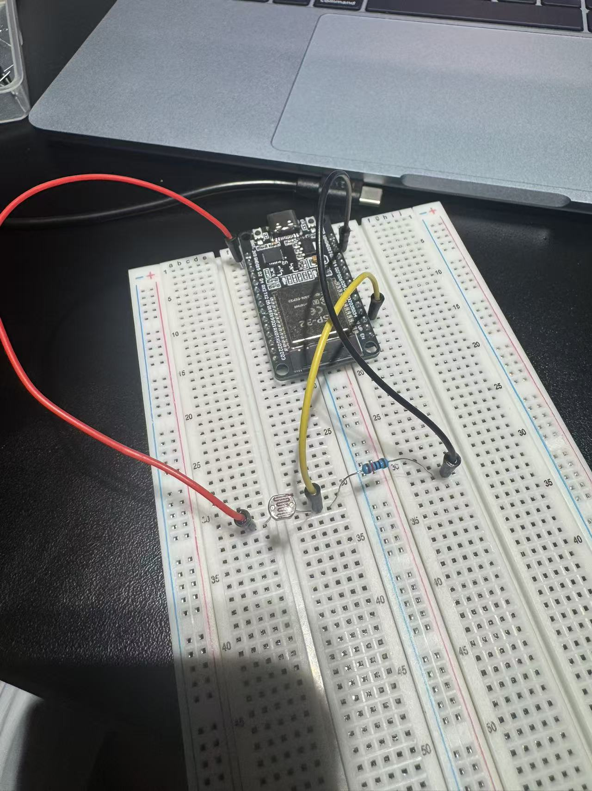

# Module 1: Foundations, Measurement and the Sensor Chain

Student: Haocheng Feng. Course: HSBI Sensorik und Aktorik, WS 2026/27.

This page collects the actual hardware experiment records through Task 4. Reports, source programs, original circuit photographs, screenshots and saved readings are linked below. The instructor-requested scope ends after Task 4; Task 5 filtering has not been performed. Personal reflections remain separate from these experimental records.

## Experiment records

| Task | Report and evidence | Recorded work and limits |
| --- | --- | --- |
| LED bring-up | [LED and Blink](led-blink/README.md) | Initial LED circuit, source program and serial screenshot. |
| Task 1 — LED, button and debounce | [Report](button-debounce/README.md) · [Code](button-debounce/button-debounce.ino) · [Serial excerpt](button-debounce/observed-serial.csv) | Physical button-controlled LED, pull-up input, software debounce and cumulative raw/accepted counts. The counts are not an isolated ten-press trial; hardware debounce was not tested. |
| Task 2 — Serial plotting | [Report](serial-plotter/README.md) · [Code](serial-plotter/serial-plotter.ino) · [Captured plot](serial-plotter/button-traces.png) | Raw input, debounced state and LED command traces. The plot's sampling interval does not resolve fast contact bounce. |
| Task 3 — Potentiometer ADC | [Report](potentiometer-adc/README.md) · [Code](potentiometer-adc/potentiometer-adc.ino) | 12-bit and 10-bit manipulation records and stationary comparisons; interrupted attempts retained. No independent multimeter voltage comparison. |
| Task 4 — LDR divider | [Report](ldr-divider/README.md) · [Code](ldr-divider/ldr-divider.ino) · [All readings](ldr-divider/measurements/readings.csv) | Circuit photograph, four qualitative light conditions, 12 trials / 120 readings, repeatability comparison and one approximate resistance calculation. Initial covering attempts are retained and explained. |

## Screenshot galleries

- [LED bring-up screenshot](led-blink/README.md#screenshot-evidence)
- [Task 1 wiring and serial counter screenshots](button-debounce/README.md)
- [Task 2 baseline and button-transition plots](serial-plotter/README.md)
- [Task 3 ADC movement, endpoints and stationary comparisons](potentiometer-adc/README.md#screenshot-evidence)
- [Task 4 upload, lighting conditions and repeat measurements](ldr-divider/README.md#screenshot-evidence)

## Task 3 capture sets

- [12-bit manipulation and recovered stationary readings](potentiometer-adc/run12-2026-10-25-02/README.md)
- [10-bit stationary comparison and an interrupted manipulation attempt](potentiometer-adc/run10-2026-10-25-01/README.md)
- [Successful repeat at 10 bits](potentiometer-adc/run10-2026-10-25-02/README.md)
- [Earlier interrupted 12-bit attempt](potentiometer-adc/run12-2026-10-25-01/README.md)

## Task 4 overview

The divider is `3V3 -> LDR -> GPIO34 measurement node -> 10 kOhm -> GND`. Revised dark covering produced Raw = 0, shade produced approximately 1163–1187, initial room light 3394–3445 and flashlight illumination 3715–3779. Room-light readings returned to a similar range after the other conditions were removed. These are observed raw-code ranges under qualitative lighting, not lux measurements.

The saved intermediate reading ADC_mV = 1089 gives an approximate LDR resistance of 20.3 kOhm, using an assumed 3.3 V supply and nominal 10 kOhm resistor. The full report distinguishes ADC voltage estimates from independent voltage measurements and explains endpoint limitations.

## Remaining measurements and reflection

A multimeter was unavailable: LED forward voltage/current, potentiometer voltage checks and independent LDR voltage verification have not been completed. The LDR's lux response, temperature coefficient and response time were not measured. The reports distinguish observations from illustrative calculations, software commands and untested circuit alternatives.

[Reflection 1 — personal reflection pending](../Reflections/ref01.md) · [Portfolio home](../README.md)

Course source: [Module 1 workbook](https://github.com/iotempire/iotempire-teaching/blob/main/full-classes/hsbi-sensors-actuators-10d/modules/01-foundations-measurement-and-sensor-chain.md).
