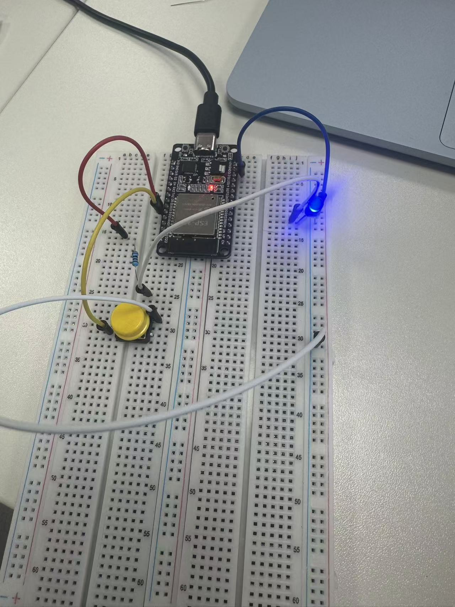
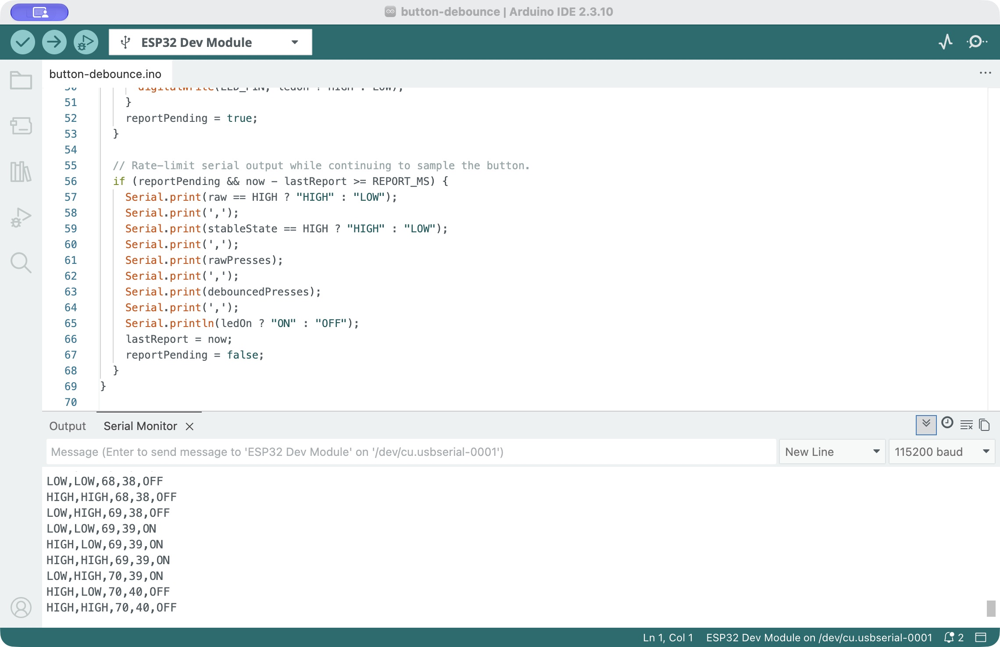

# Task 1: LED, Button and Software Debouncing

Date: 2026-10-21

## Hardware and wiring

- Board: Joy-IT SBC-NodeMCU-ESP32-C (NodeMCU ESP32 USB-C).
- External LED: blue, with a 220 ohm series resistor. The resistor value was reported by the student; it has not been independently measured.
- LED connection: GPIO18 -> resistor -> LED anode; LED cathode -> GND.
- Button connection: GPIO19 -> normally open button -> GND.
- Input mode: `INPUT_PULLUP`. Released = HIGH; pressed = LOW.
- Serial monitor: 115200 baud.



## Resistor calculation

The approximate current is `I = (V_GPIO - V_f) / R`.

Using a nominal HIGH output of 3.3 V and R = 220 ohms:

`I = (3.3 V - V_f) / 220 ohms`

The blue LED's forward voltage has not been measured. For an illustrative assumption of V_f = 3.0 V, the estimate is approximately 1.36 mA. This is a calculation, not a measured current. The earlier 2.0 V example for a red LED does not describe this blue LED. Actual output voltage, LED forward voltage and current still need measurement.

## Pull-up and pull-down

External pull-up equivalent to the internal pull-up used in this test:

```text
3V3 -- 10 kOhm --+-- GPIO input
                |
              Button
                |
               GND

Released = HIGH; pressed = LOW
```

Alternative pull-down circuit (drawn, not tested):

```text
3V3 -- Button --+-- GPIO input
               |
            10 kOhm
               |
              GND

Released = LOW; pressed = HIGH
```

Without a pull-up or pull-down, an open button can leave the input floating, allowing leakage and interference to determine the reading. An external 10 kOhm pull-up gives a known resistance and can provide a lower-impedance input than a weak internal pull-up. This can help with interference, at the cost of additional current while pressed. Long wires may still require further filtering or wiring improvements.

## Program and observations

The [program](button-debounce.ino) counts raw HIGH-to-LOW transitions separately from debounced presses. It accepts a new stable state only after the input has stayed unchanged for 30 ms. Each accepted press toggles the LED. Serial output is rate-limited with `millis()`; there is no blocking `delay()` in the loop.

- The student confirmed that the physical button successfully toggled the external LED.
- The latest captured cumulative reading was 70 raw presses and 40 debounced presses, with the button released and the LED off.
- These totals include previous interaction. They are not the result of an isolated ten-press trial, and the physical number of presses was not independently counted.
- More raw transitions than accepted presses is consistent with suppression of bounce or other input disturbances. This record does not isolate the source of every additional transition or prove that every physical press was counted exactly once.
- The CSV is a visible excerpt from the serial monitor, not a complete recording of the run. `raw_state` and `stable_state` can differ while the 30 ms stable-state condition is pending.

[Observed serial excerpt](observed-serial.csv)



## Troubleshooting and remaining work

The LED initially stayed off. After correcting the breadboard connections, the student reported that it lit up. Connections must share the same connected five-hole row; the centre trench separates the two terminal groups.

Remaining checks: measure the LED forward voltage/current, conduct a controlled press-count comparison if needed, and optionally compare an external pull-up or hardware debounce circuit. Hardware debounce has not been tested in this record.
