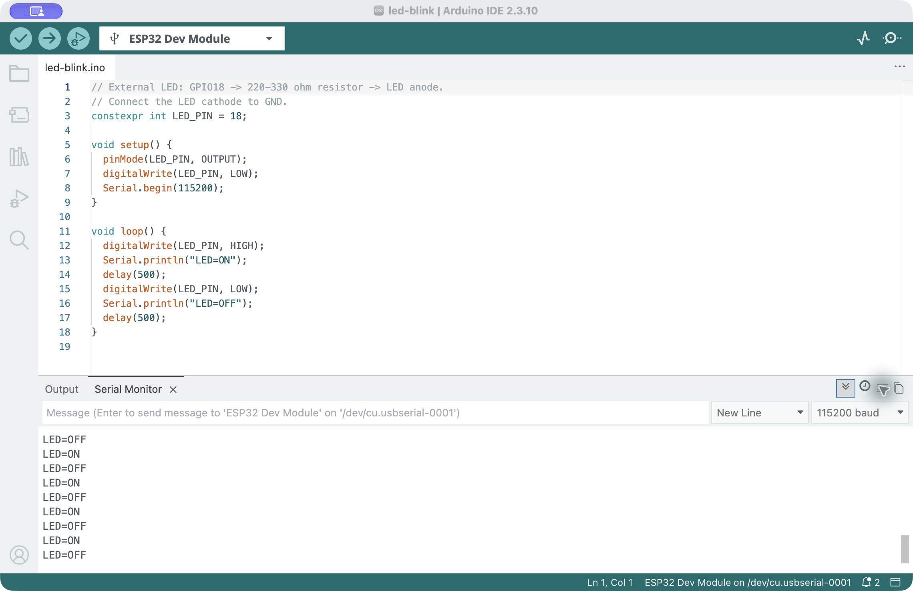

# LED bring-up and Blink

The initial LED exercise preceded the button and ADC experiments. The external circuit uses GPIO18, a series resistor reported as 220 ohm, a blue LED and GND. The student confirmed that the LED lit after the breadboard connection was corrected.

[Source program](led-blink.ino) · [Saved Arduino serial screenshot](arduino-serial.png)

The Blink program commands the LED on and off every 500 ms and prints `LED=ON` / `LED=OFF` at 115200 baud. The serial command labels do not independently measure optical brightness. LED forward voltage and current were not measured. The resistor calculation and subsequent button-controlled LED experiment are recorded in [Task 1](../button-debounce/README.md).

## Screenshot evidence

The serial text records software commands; it does not independently measure the LED's light output.
