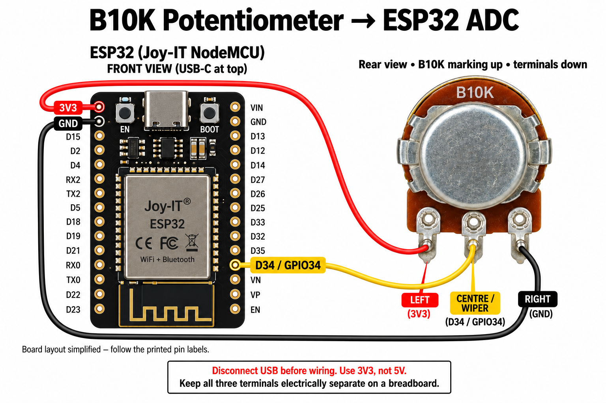
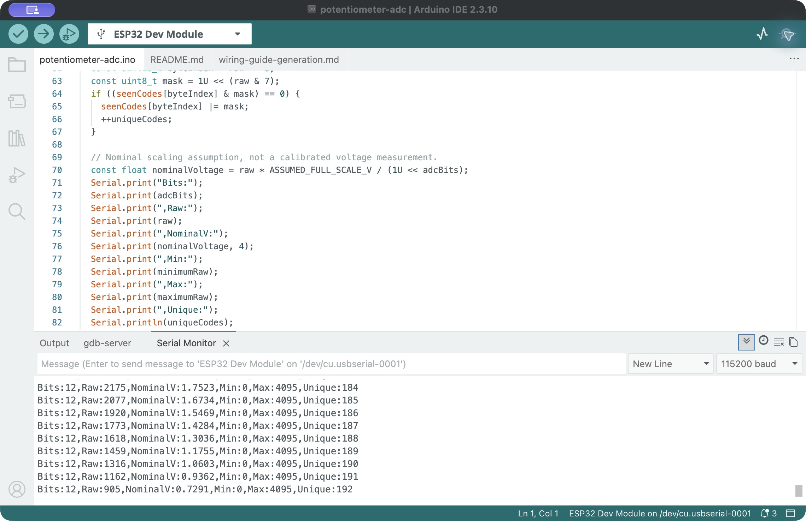
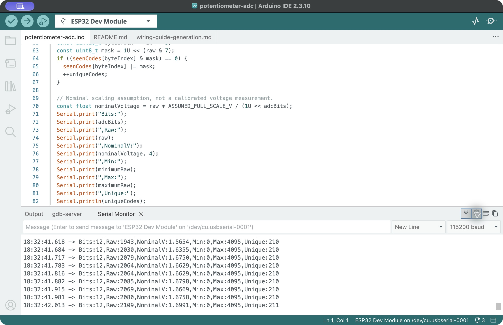
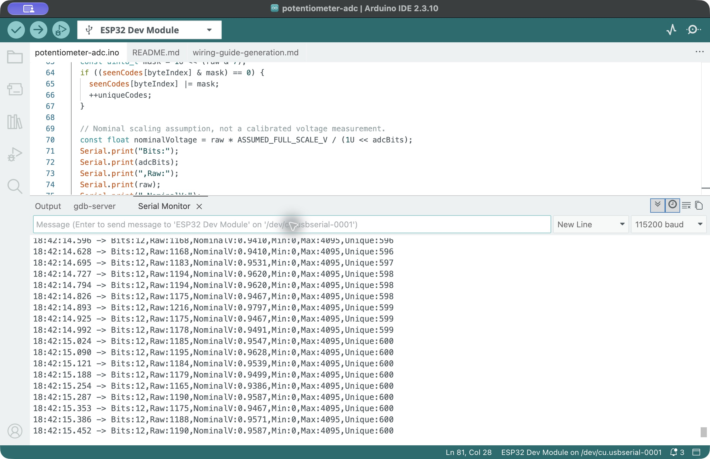
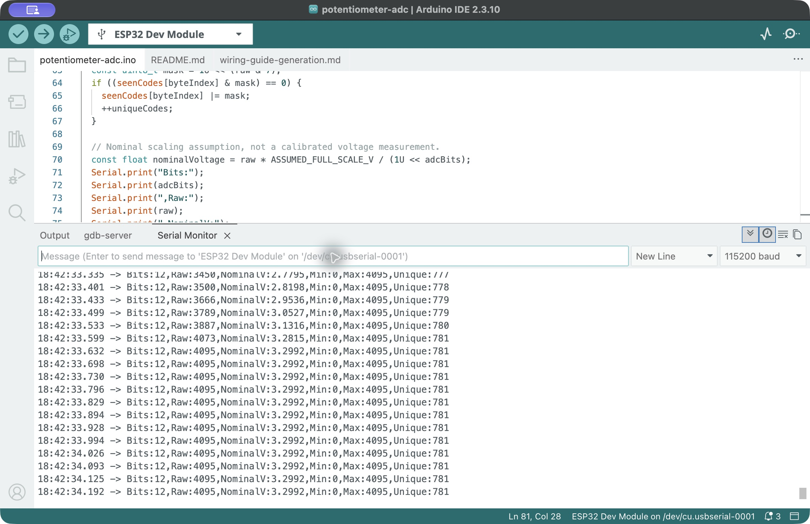
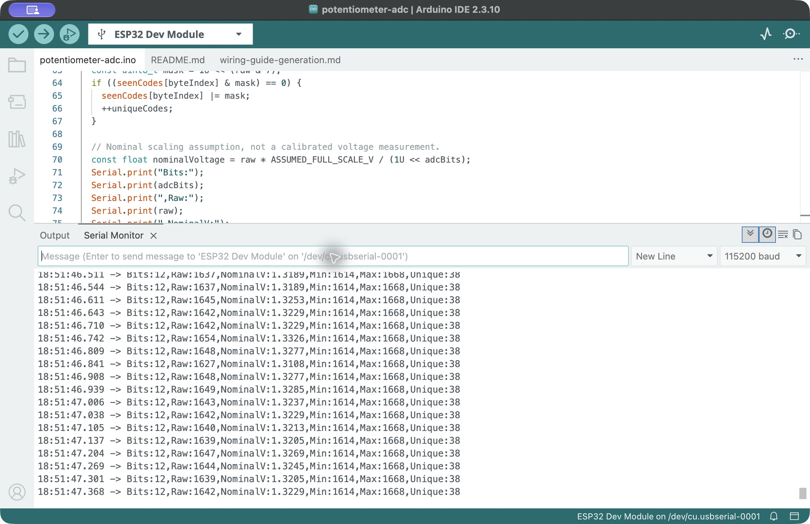
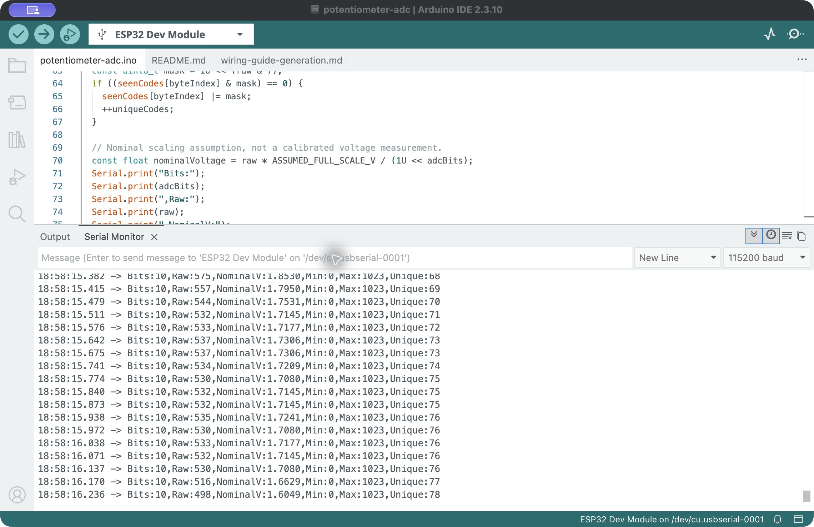

# Task 3: The ADC Precision Dance

Status: Hardware manipulation sequences at 12 and 10 bits and stationary captures at both resolutions have been saved. The repeat 10-bit acquisition retained 10-bit output in every saved window. Independent voltage measurements remain pending because no multimeter was available. An earlier unexpected resolution reset remains unexplained.

## Wiring

The photographed potentiometer is marked B10K, indicating a nominal resistance of 10 kOhm. Its resistance has not yet been measured.

The illustration shows the potentiometer from the rear with B10K at the top and the terminals pointing down. Left connects to 3V3, centre/wiper to D34 / GPIO34, and right to GND. Follow the actual board's printed labels. Keep the three potentiometer terminals in electrically separate breadboard groups.

Verify the potentiometer's terminal arrangement before wiring. For a bare three-terminal potentiometer, connect the two ends of the resistance track to 3V3 and GND, and the wiper to D34 / GPIO34. Swapping the track ends reverses the direction of increasing readings. Keep the wiper voltage between GND and 3V3; do not use 5 V.

The existing GPIO18 LED and GPIO19 button circuit may remain connected. This program holds the LED off and reads only the potentiometer.

### Wiring troubleshooting, 2026-10-25

The student reported that the board's red indicator went out when the potentiometer was connected. Removing the external wiring restored the indicator. Clearer photographs confirmed the board-side connections as 3V3, GND and D34; an earlier angled photograph had been misread.

Subsequent photographs suggested that the potentiometer's three terminals occupied the same connected five-hole breadboard group. The potentiometer was removed from that group, keeping its terminals electrically separate. The student then reported that the indicator stayed on. This supports a wiring short as the explanation; no resistance or current measurement was available to verify the fault electrically. Board-side pins were not to be moved based on the earlier misreading.

## Program settings

- Board: ESP32 Dev Module, Joy-IT SBC-NodeMCU-ESP32-C.
- Analog input: GPIO34.
- Attenuation: `ADC_11db`.
- Initial resolution: 12 bits.
- Nominal sampling interval: 50 ms, approximately 20 samples per second.
- Serial baud rate: 115200.

| Command | Action |
| --- | --- |
| H | Select 12 bits and clear the statistics. |
| L | Select 10 bits and clear the statistics. |
| R | Clear the statistics without changing resolution. |

The serial fields are Bits, Raw, NominalV, Min, Max and Unique. Unique counts distinct codes encountered in the sampled readings since the last reset. It does not count every theoretical code, capture every code passed during a sweep, or establish the ADC's effective resolution. Noise can also change this count.

## Nominal voltage model

`NominalV = Raw × 3.3 / 2^Bits`

The 3.3 V value is an assumed full-scale span for this exercise, not a measurement of the ESP32's internal ADC reference or a calibrated input range. Attenuation, reference variation, noise, offset, saturation and nonlinearity can make the actual input voltage differ from this nominal estimate. Compare against a multimeter.

| Setting | Representable codes | Maximum code | Ideal step for the assumed 3.3 V span |
| --- | --- | --- | --- |
| 12 bits | 4096 | 4095 | Approximately 0.806 mV |
| 10 bits | 1024 | 1023 | Approximately 3.223 mV |

These are theoretical values, not observed hardware results. Changing resolution does not by itself establish a change in accuracy.

## Measurement plan

1. Send H and slowly sweep the potentiometer from one end to the other. Record observed Min, Max and Unique, together with sweep duration and sampling settings.
2. Hold a fixed intermediate position and record several consecutive readings to examine variation.
3. Send L and repeat the sweep and fixed-position observations.
4. Measure the wiper voltage relative to GND with a multimeter at several positions and compare it with NominalV. Record the meter reading and nominal estimate separately.
5. Document any flat or erratic regions near the ends of the input range without assuming ideal endpoint behavior.

## Initial hardware communication check, 2026-10-25

The first upload attempts failed with `termios.error: (22, 'Invalid argument')`. Upload speed was changed from 921600 to 115200. Upload succeeded after the student disconnected and reconnected USB; the written data passed hash verification. These changes were not isolated, so this record does not establish which one resolved the serial error.

The Serial Monitor then showed real hardware output at 115200 baud. One visible excerpt contained Raw readings 1390, 1376, 1390, 1375 and 1383 at 12 bits. Their corresponding NominalV values were generated using the stated full-scale assumption; they are not independent voltage measurements. The running statistics in that excerpt were Min = 1221, Max = 4095, Unique = 133. This was an initial communication check, not a controlled full sweep or a verified fixed-position noise test.

Later manipulation and stationary observations at both resolutions are recorded below. Independent multimeter measurements remain pending.

[Initial live serial excerpt](initial-12bit.txt)

The saved excerpt was captured after the earlier observation described above, so its running statistics may differ. It is a visible excerpt, not a complete timed recording.

### Acquisition interruption

The student reported that the ADC display stopped updating while the board's red indicator remained on. Reopening the monitor produced: `Invalid serial port: error setting term settings: invalid argument`. This confirms a host serial-open/configuration failure; it does not establish that the ADC firmware stopped executing. The existing excerpt is retained, but the controlled sweep and stationary-reading comparison must be repeated after reliable communication is restored.

The student then changed the Mac USB connection. After reselecting the serial port and reopening the monitor, fresh 12-bit output resumed. Receive timestamps were enabled and continued advancing while Raw = 0, Min = 0, Max = 0 and Unique = 1. Thus, an unchanged numerical value did not mean the display had stopped. A knob sweep is still required to confirm the response to position. The reason for the earlier serial failure has not been isolated.

## Recorded 12-bit manipulation sequence, 2026-10-25

[Capture record and limitations](run12-2026-10-25-02/README.md) · [Visible serial excerpts](run12-2026-10-25-02/visible-excerpts.csv)

Twelve screenshots were saved while the student manipulated the knob. The final running statistics were Min = 0, Max = 4095 and Unique = 824. These statistics cover the period since the verified reset, approximately 69 seconds; screenshot acquisition itself lasted approximately 34 seconds. This is not a measured single sweep or an effective-resolution measurement.

A following stationary attempt could not be validated because receive timestamps stopped advancing. Reopening the monitor again produced a serial-open/configuration error. The saved stale screenshot is retained as troubleshooting evidence, not a stationary dataset.

## Recovered stationary comparison, 2026-10-25

Restarting Arduino IDE restored live reception. With the student instructed to keep the knob fixed, six screenshots were saved at each resolution. Each set contains 114 timestamped visible samples with gaps between monitor windows.

| Saved-sample statistic | 12 bits | 10 bits |
| --- | ---: | ---: |
| Raw minimum–maximum | 1619–1668 | 402–417 |
| Mean raw code | 1641.04 | 409.74 |
| Population standard deviation in codes | 6.94 | 2.08 |

These are descriptive statistics of the saved excerpts only. The code ranges scale with resolution; lower code-unit fluctuation at 10 bits does not show better voltage accuracy.

[10-bit observation record, screenshots and limitations](run10-2026-10-25-01/README.md)

During the following manipulation attempt, output changed unexpectedly from 10 bits to 12 bits with reset statistics. The student reported only turning the knob. The cause remains unresolved, so the attempt is not a completed uninterrupted 10-bit sweep. Original screenshots preserve the change.

## Successful repeat at 10 bits, 2026-10-25

[Repeat 10-bit capture record](run10-2026-10-25-02/README.md) · [Saved serial rows](run10-2026-10-25-02/visible-excerpts.csv)

Eighteen screenshots were saved over approximately 36 seconds. Every saved capture window showed Bits = 10, advancing receive timestamps and no visible port error or reset of statistics. The final complete saved serial row at 18:58:47.890 showed Min = 0, Max = 1023 and Unique = 257. Both raw endpoints also appear directly in the saved readings.

The running statistics cover approximately 50 seconds since selecting L, longer than screenshot acquisition. The 341 saved complete serial rows are intermittent visible excerpts, not a continuous record of all conversions. The earlier unexpected return to 12 bits did not recur in the saved windows of this repeat; its cause has not been isolated.

The 12-bit and 10-bit hardware comparison is now documented. Independent voltage comparison, calibrated accuracy and quantitative linearity measurements have not been completed.

## Screenshot evidence

The following original captures show selected stages of the hardware experiment. Each screenshot is a visible monitor window; the capture sets and CSV files preserve the time coverage and limitations. The running Min, Max and Unique fields can cover a longer interval than the currently visible rows.

### 12-bit manipulation: intermediate values and upper endpoint

These separate windows show intermediate readings and the representable upper endpoint. They do not establish a calibrated voltage or a linear response to knob angle.

### Fixed-position comparison at 12 and 10 bits

The student was instructed to hold the same position. The output code scale changes with resolution; different fluctuations in code units do not by themselves show different voltage accuracy.

### Repeat 10-bit manipulation: upper and lower endpoints

### Repeat 10-bit manipulation: intermediate values and final statistics

The final running statistics were Min = 0, Max = 1023 and Unique = 257. Unique counts codes sampled since reset; it is not the ADC's effective resolution. All 18 saved windows of this repeat retained 10-bit output.
