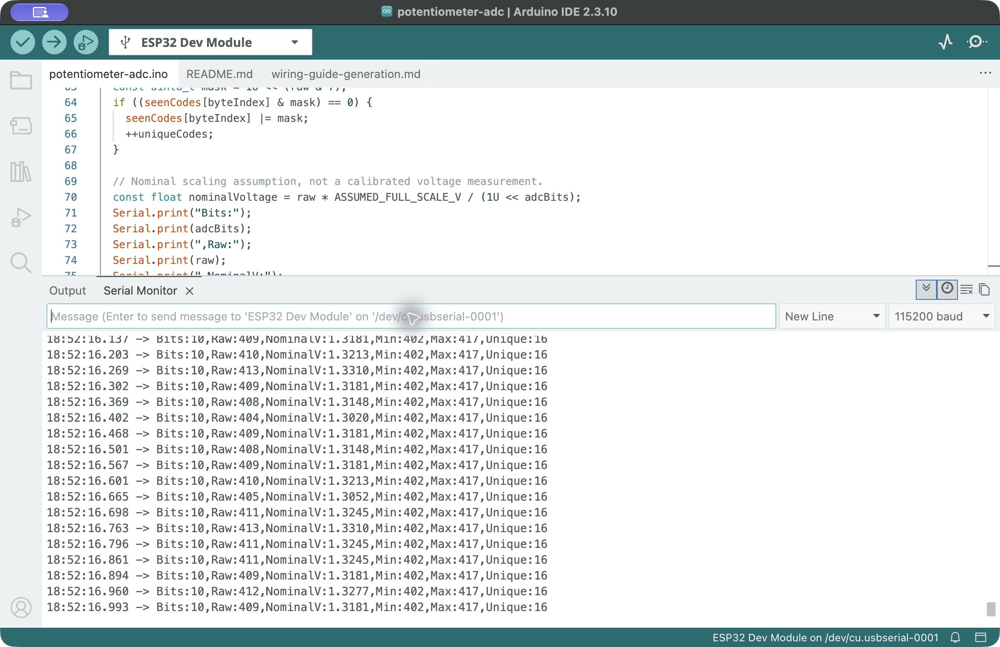
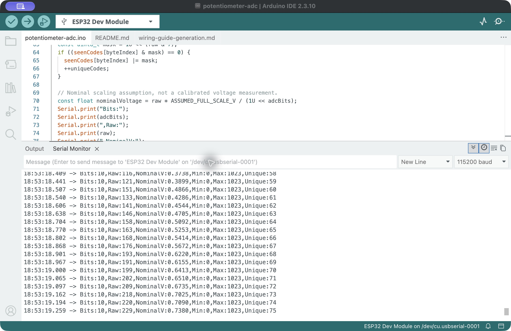
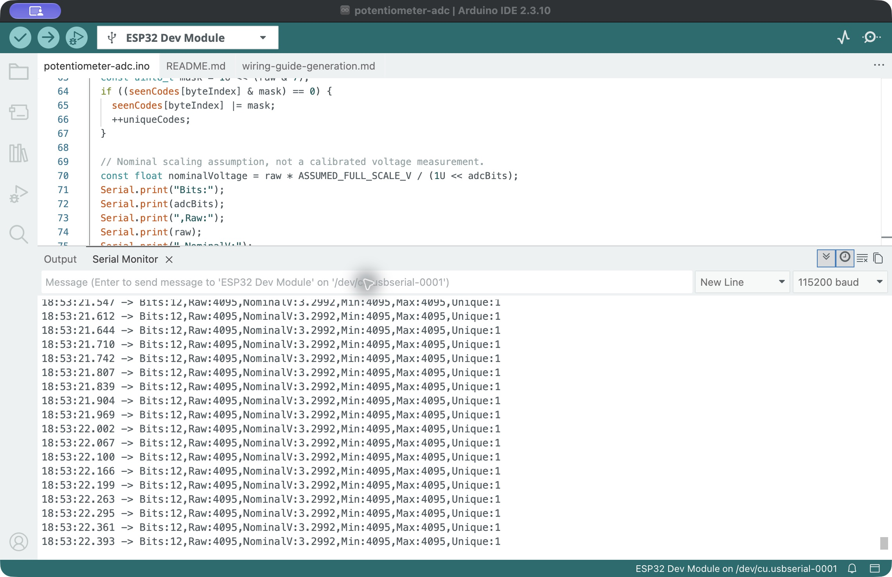

# 10-bit ADC observation — 25 October 2026

## Stationary comparison

After the 12-bit stationary capture, L selected 10-bit output and reset the running statistics. The student was instructed to keep the same knob position throughout both captures. No independent position measurement was available. GPIO34, ADC_11db attenuation, a nominal 50 ms sample interval and 115200 baud were unchanged.

Six original screenshots show advancing receive timestamps between approximately 18:52:10.317 and 18:52:16.796 local time. The visible excerpts contain 114 distinct timestamped samples with gaps between windows. This is a set of saved excerpts, not a complete continuous stream.

| Saved-sample statistic | 12-bit capture | 10-bit capture |
| --- | ---: | ---: |
| Number of saved samples | 114 | 114 |
| Minimum raw code | 1619 | 402 |
| Maximum raw code | 1668 | 417 |
| Mean raw code | 1641.04 | 409.74 |
| Population standard deviation, raw codes | 6.94 | 2.08 |

The mean code is approximately four times larger at 12 bits, consistent with four times as many output codes across the same nominal span. A smaller standard deviation in code units at 10 bits does not establish better accuracy: each 10-bit code represents four times the nominal voltage step. Using the assumed 3.3 V span, the observed standard deviations correspond to approximately 5.59 mV and 6.71 mV respectively. These are nominally scaled fluctuations, not calibrated voltage or intrinsic ADC noise measurements. The short, sequential, gapped captures do not isolate drift, contact noise, quantization and ADC noise.

The final 10-bit running statistics were Min = 402, Max = 417 and Unique = 16. These cover the longer interval since L was sent at approximately 18:52:02, not only the saved excerpt interval. Unique counts sampled codes, not effective resolution.

[Saved stationary samples](stationary-visible-excerpts.csv) · [Summary](stationary-summary.json)

## Interrupted manipulation attempt

R was sent at approximately 18:53:05 to reset the 10-bit statistics. The student was then instructed to turn from one end to the other and return to an intermediate position. Twelve screenshots were saved over approximately 34 seconds.

The first two saved screenshots show 10-bit output. The second shows Min = 0, Max = 1023 and Unique = 71 at receive time 18:53:19.065. By the third screenshot, at approximately 18:53:22, the display shows Bits = 12, Raw = 4095, Min = 4095, Max = 4095 and Unique = 1. The supplied program defaults to 12 bits during setup; this change and reset are consistent with a restart, but the reset cause has not been identified or confirmed from a boot log. No resolution-change command was sent by the assistant during the capture. The student reported that they only turned the knob, without unplugging USB, pressing EN/Reset or noticing a red-indicator interruption.

This attempt cannot be reported as a complete uninterrupted 10-bit sweep. The capture script retained only lines labeled Bits:10, so text excerpts from `sweep-02` onward are empty while the original screenshots retain the displayed 12-bit evidence. The index's error flag checks only certain visible port-error messages; a false value does not establish that no hardware reset occurred.

A repeat 10-bit sweep should follow inspection of the potentiometer connections and investigation of the unexpected reset. Independent voltage comparison is pending because no multimeter is available.

## Later repeat

A subsequent 10-bit manipulation sequence was saved with 10-bit output in all 18 observed capture windows. Its final running limits were 0 and 1023, with Unique = 257. See the [repeat capture record](../run10-2026-10-25-02/README.md). The earlier interruption and its original evidence remain part of this record.
