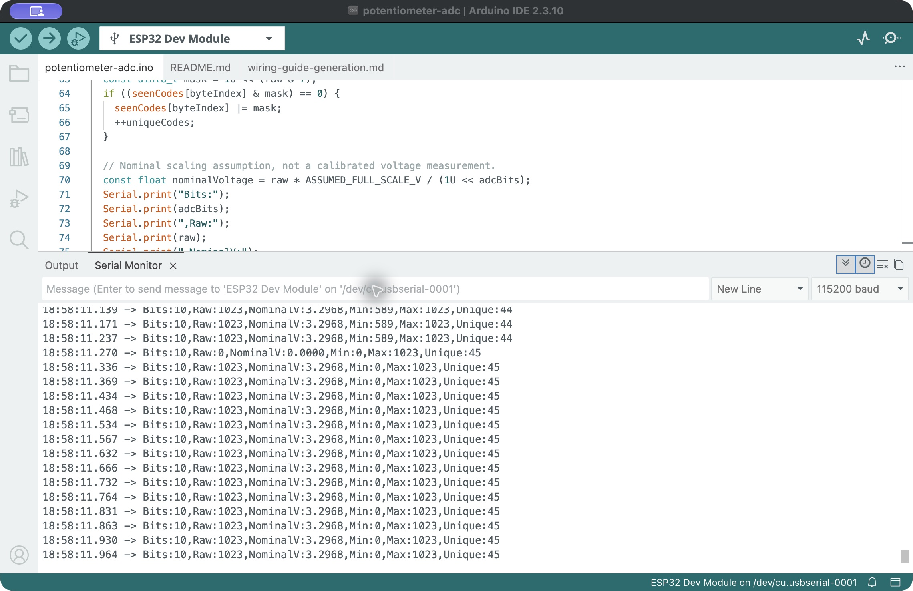
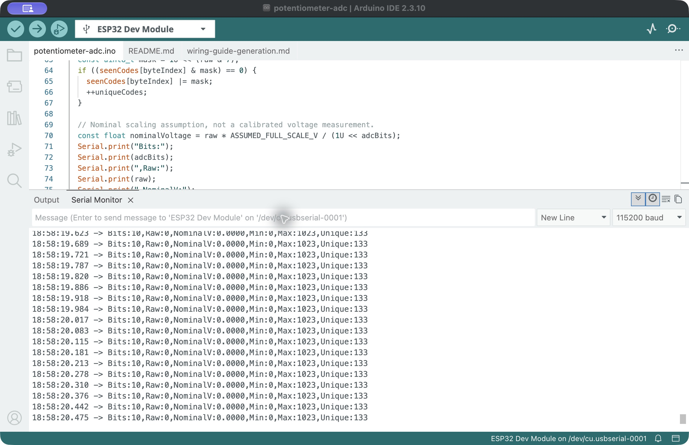

# 10-bit potentiometer manipulation — 25 October 2026

## Result

A repeat hardware run was recorded with 10-bit output throughout all 18 saved capture windows. Receive timestamps advanced, running statistics did not reset in the saved excerpts, and no port-error or disconnected message was observed during this acquisition. The final saved complete serial row was received at 18:58:47.890 local time:

`Bits:10,Raw:361,NominalV:1.1634,Min:0,Max:1023,Unique:257`

Both endpoints, 0 and 1023, also occur directly in the saved readings. The student had confirmed that the wiring was correct before this repeat; no wiring changes or firmware modifications were made for this run.

## Acquisition

- Board: Joy-IT SBC-NodeMCU-ESP32-C, selected as ESP32 Dev Module.
- Potentiometer: B10K; track ends connected to 3V3 and GND, wiper connected to GPIO34.
- Resolution: 10 bits, selected by sending L; attenuation: ADC_11db.
- Nominal sample interval: 50 ms, serial: 115200 baud.
- L and the resulting 10-bit statistics were recorded at approximately 18:57:58 local time in `baseline.txt` and `baseline.png`.
- The student was instructed to move slowly between the ends and return to an intermediate position. The exact number and duration of mechanical traversals were not independently measured.
- Eighteen screenshots were saved at approximately two-second intervals, from 18:58:12 to 18:58:48 local time, about 36 seconds.
- The saved text excerpts contain 341 complete timestamped rows from 18:58:10.876 to 18:58:47.890, with gaps between visible monitor windows. A partial final row in one excerpt was retained in the original text but omitted from the CSV.

[Complete saved visible rows](visible-excerpts.csv) · [Capture index](capture-index.json) · [Summary](summary.json)

The running statistics cover approximately 50 seconds since selecting L, including time before the screenshot sequence. Unique = 257 is the number of different codes sampled since that reset; it is not a count restricted to the screenshot interval, not the theoretical code count, and not effective resolution. The intermittent UI captures do not establish that every conversion was recorded or exclude brief events between snapshots. The previous unexpected return to 12 bits remains unexplained; it was not observed in this repeat.

## Evidence

## Interpretation

| Resolution | Representable raw range | Observed running minimum | Observed running maximum | Final running distinct-code count |
| --- | --- | ---: | ---: | ---: |
| 12 bits, earlier run | 0–4095 | 0 | 4095 | 824 |
| 10 bits, this run | 0–1023 | 0 | 1023 | 257 |

The output range changes with the selected resolution. The distinct-code counts are descriptive observations from different movements and acquisition durations; their ratio must not be interpreted as effective resolution or measurement accuracy. Stationary comparisons were recorded separately before this run.

`NominalV = Raw × 3.3 / 2^Bits` uses an assumed 3.3 V full-scale span. It is not a calibrated voltage measurement. Saturation at the upper code does not prove that the wiper voltage equals the nominal full-scale value. No multimeter was available, so independent voltage checks and a quantitative linearity assessment remain pending.
