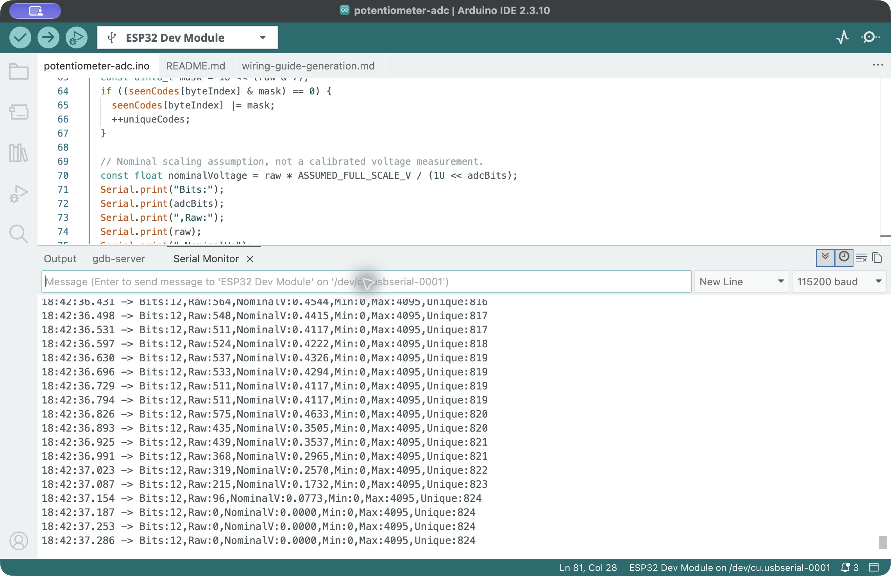

# 12-bit potentiometer observation — 25 October 2026

The student manipulated the potentiometer while real ESP32 serial output was captured. Twelve original screenshots and their visible serial excerpts were saved. No disconnection was reported by the UI during those captures.

## Acquisition settings and coverage

- GPIO34, 12-bit output, ADC_11db attenuation, nominal sample interval 50 ms, serial 115200 baud.
- H was sent and the statistics reset was observed at approximately 18:41:28 local time: Min = 0, Max = 0, Unique = 1.
- Screenshot acquisition ran from approximately 18:42:03 to 18:42:37 local time (about 34 seconds). The running statistics include the earlier time since reset, approximately 69 seconds in total.
- The visible excerpts are intermittent snapshots of the monitor, not a continuous serial recording. `visible-excerpts.csv` combines these excerpts and removes duplicate receive timestamps. The capture index stores screenshot acquisition times in UTC; receive timestamps displayed by the IDE are local time.

## Observations

The final saved capture showed Bits = 12, Raw = 0, Min = 0, Max = 4095 and Unique = 824. Intermediate captures showed changing values, including 3493, 1300, 435 and 2707. This documents a response while the knob was being manipulated. The number and timing of complete end-to-end traversals were not independently measured.

The running limits reached both representable endpoints. This does not demonstrate linearity, voltage accuracy, or complete coverage of all codes. Unique = 824 is the number of distinct sampled codes since reset, not effective resolution or the number of codes captured only during the screenshot interval. NominalV is calculated with an assumed 3.3 V span and is not a multimeter measurement.

## Stationary acquisition interruption

The student confirmed that the knob had been stopped near the middle and released. An attempted capture did not produce a verified five-second live interval. The saved `stationary-start.png` and `.txt` show a stale display ending at 18:43:34.042. Reopening the monitor produced `Invalid serial port: error setting term settings: invalid argument`, saved in `stationary-reconnect.txt` and `.png`. These files document an acquisition problem, not a completed stationary noise test. Values from this stale excerpt must not be used as a verified stationary dataset.

The student subsequently unplugged and reconnected USB and reported a steady red indicator. The same host serial-open error remained immediately after reconnecting. Its cause has not been isolated.

## Recovered stationary observation

Restarting Arduino IDE restored live serial reception. The student had been asked to keep the knob fixed and reported it stopped and released. Six screenshots show advancing receive timestamps from approximately 18:51:40.615 to 18:51:47.137 local time. The source excerpts contain 114 distinct timestamped samples with small gaps between visible windows; they are not a continuous recording of every conversion.

Within those saved samples: minimum = 1619, maximum = 1668, mean = 1641.04 codes, population standard deviation = 6.94 codes. These statistics are computed only from the saved visible samples. The device's final running statistics were Min = 1614, Max = 1668 and Unique = 38; these cover the longer interval since R was sent at approximately 18:51:30. They must not be confused with the excerpt-only statistics.

[Saved stationary samples](stationary-visible-excerpts.csv) · [Summary](stationary-summary.json)

The position was held fixed according to the student's confirmation; no independent mechanical position measurement was available. Variation is observed, but its separate electrical, contact and ADC contributions have not been isolated.

## Remaining measurements

A later 10-bit stationary comparison was also saved. A subsequent 10-bit manipulation attempt changed unexpectedly back to 12 bits, so a complete uninterrupted 10-bit sweep remains pending. Independent wiper-voltage measurements remain pending because the student has no multimeter available.

## Later repeat

A subsequent 10-bit manipulation sequence was saved with 10-bit output in all 18 observed capture windows. Its final running limits were 0 and 1023, with Unique = 257. See the [repeat capture record](../run10-2026-10-25-02/README.md). The earlier interruption and its original evidence remain part of this record.
