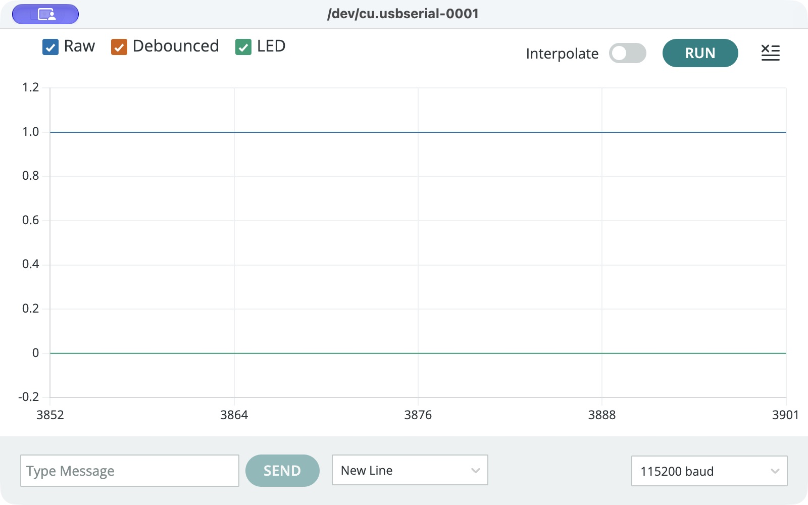
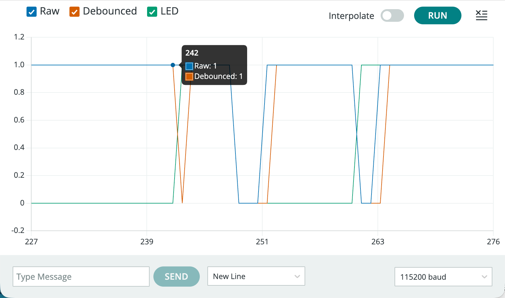

# Task 2: Serial Console and Real-Time Plotting

## Configuration

- Board: ESP32 Dev Module, Joy-IT SBC-NodeMCU-ESP32-C.
- LED: GPIO18 -> 220 ohm resistor -> LED anode; LED cathode -> GND.
- Button: GPIO19 -> normally open button -> GND; `INPUT_PULLUP` enabled.
- Serial baud rate: 115200.
- Nominal reporting interval: 100 ms, approximately 10 samples per second. This rate has not been independently measured. With 50 displayed samples, the plot covers approximately five seconds.
- Debounce interval: 30 ms of unchanged raw input.

## Numerical output

Each serial line has the format `Raw:<0 or 1>,Debounced:<0 or 1>,LED:<0 or 1>`. These labels identify the three traces in Arduino Serial Plotter.

| Trace | Meaning |
| --- | --- |
| Raw | Instantaneous button reading: released = 1; pressed = 0. |
| Debounced | Accepted button state after the input stays unchanged for 30 ms. |
| LED | Commanded output: on = 1; off = 0. This is not an independent optical measurement. |

The plot shows sampled states. A transition faster than the reporting interval may be missed, so this plot is not a complete measurement of contact bounce.

## Loop timing

The program uses `millis()` to decide when to send the next sample. The loop continues checking the button between reports. A blocking `delay(100)` would prevent those checks during the wait. Actual timing can also be affected by processing and serial transmission.

## Captured baseline

The first paused screenshot contained samples 3852 through 3901, showing Raw = 1, Debounced = 1 and LED = 0 throughout the visible window. It captured a released button and a low LED command, but no button transitions. The original 20 ms reporting interval covered approximately one second; it was changed to 100 ms to make manual capture easier. The 30 ms debounce setting is unchanged. A 100 ms plot cannot resolve the debounce interval or fast contact bounce.

## Observation checklist

- [x] Operate the physical button and pause the plot with transitions visible.
- [x] Identify the Raw and Debounced transitions and the LED's retained state after release.
- [x] Save a screenshot containing real transitions.
- [x] Describe observable differences without claiming unresolved fast transitions were captured.

## Observed transitions

The student supplied this paused Serial Plotter screenshot after operating the physical button. The horizontal axis shows sample indices 227 through 276, not seconds. With a nominal reporting interval of 100 ms, the visible span is approximately 4.9 seconds; the actual reporting interval has not been independently measured.

- Raw (blue) and Debounced (orange) change between 1 (released) and 0 (pressed).
- At some transitions, the Debounced trace changes in a later plotted sample than Raw. Other parts of the traces overlap.
- The LED command (green) switches state on accepted presses and holds that state after release. The visible window contains three LED command changes.
- The displayed segments join discrete samples. Sloping edges and intermediate plotted heights do not mean that the digital pin passed through intermediate logical states.
- The program requires 30 ms of unchanged input before accepting a state, but the 100 ms reporting interval cannot measure that delay precisely or resolve fast contact bounce. A one-sample separation is not a measurement of a 100 ms debounce setting.
- The LED trace records the commanded GPIO state. The student previously confirmed that the physical button toggled the external LED; the graph itself is not an optical brightness measurement.

This screenshot provides evidence of numerical serial output, real-time plotting, button-state changes and a retained LED control state. The separate Task 1 counter log is used to compare raw and accepted press counts.
