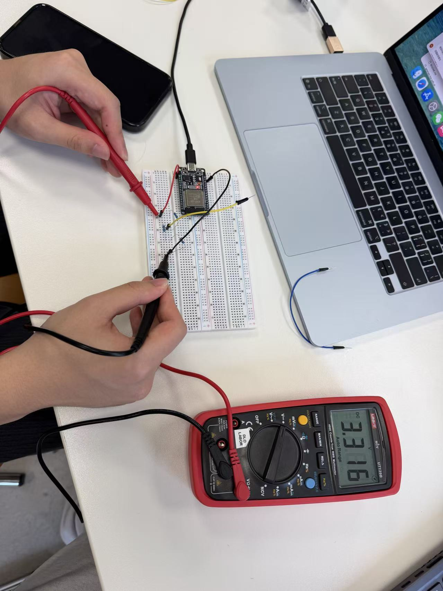
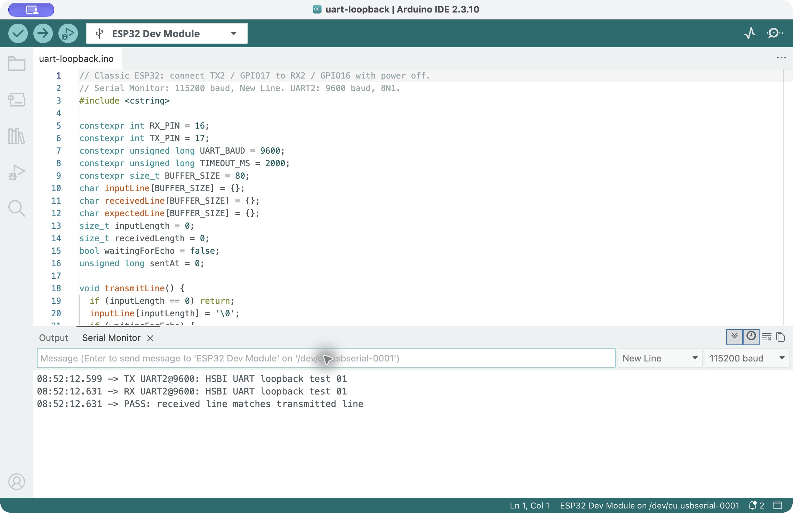
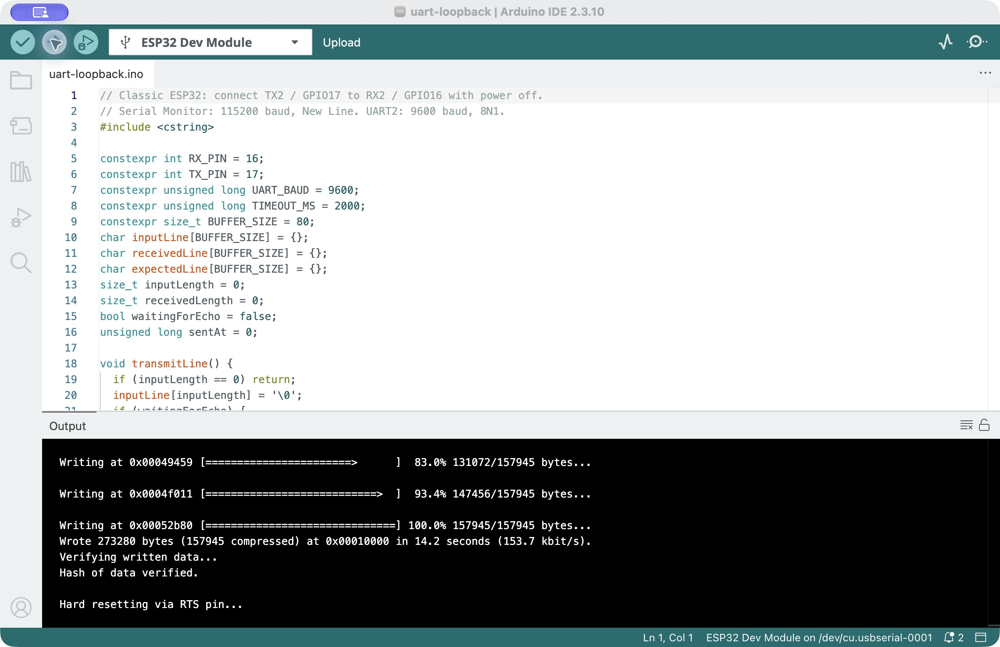

# Module 2 — Task 1: Simple Pins, PWM, UART and a Voltage Divider

Student: Haocheng Feng. Preparation date: 28 October 2026.

Status: Conceptual classification and divider calculations prepared. A hardware UART2 loopback test passed on 28 October 2026 and its output and screenshots were saved. The student obtained a multimeter and photographed an input-voltage reading of 3.316 V with the probes at the intended divider input and ground. The divider output has not yet been measured. The 5 V-input example remains untested. The instructor stopped the exercise before Vout was measured and directed the class to Task 2. Task 1 is partially complete.

## Connection baseline

| Connection | Wires | Voltage / signaling | Speed and length | Example | Failure mode |
| --- | --- | --- | --- | --- | --- |
| Digital input/output | One signal and a common ground; additional power as required | HIGH/LOW using the board's 3.3 V logic | Timing is set by the application; short breadboard connections in this lab | Button input; LED through a current-limiting resistor; relay-module control input | Floating input, mechanical bounce, excessive output current, unsuitable relay-module logic voltage |
| PWM | One pulse signal and ground; load/servo power as required | Pulses switch between the GPIO's LOW and HIGH levels | Frequency, duty cycle or pulse width depend on the device; short local wiring | LED dimming; servo command pulses | Wrong frequency/pulse width, excessive load current, missing common ground |
| Analog | One measurement signal and common ground; sensor power if needed | A continuously varying voltage within the specific ADC's supported input range | Sampling must suit signal bandwidth; noise and source impedance matter | LDR/NTC divider, compatible soil/gas-sensor analog output | Overvoltage, wrong divider orientation, poor ground, saturation or noise |
| UART | TX, RX and common ground for a full-duplex link; devices also need power | 3.3 V logic-level UART in this ESP32 test; TX connects to the peer's RX | Tested UART2 configuration: 9600 baud, 8N1; short jumper. No universal UART cable-length maximum is claimed | A second board, logic-level USB-UART adapter, or same-board loopback | Baud/framing mismatch, TX connected to TX, missing ground, RS-232 electrical levels connected directly to GPIO |

This table is a classification, not a claim that every example was connected or tested. Directly driving a bare relay coil from a GPIO is not the relay-module example described here.

## PWM is not a bus

A PWM waveform specifies pulse timing; by itself it supplies no device addressing, message framing or error-handling protocol for a shared bus. For LED dimming, duty cycle changes the time-averaged electrical drive. A hobby servo instead interprets command pulse width as a requested position; servo power is supplied separately, not from the signal pin.

## Divider calculation

```text
Sensor signal Vin ---- R1 ----+---- R2 ---- GND
                             |
                            Vout
```

`Vout = Vin * R2 / (R1 + R2)`

The course's example Vin = 5 V, R1 = 10 kOhm and R2 = 20 kOhm gives 3.333... V. That exceeds the nominal 3.3 V target and leaves no downward margin for supply and resistor variation; it must not be treated as a verified input-protection design.

A proposed alternative uses two nominal 10 kOhm resistors:

`Vout = 5 * 10000 / (10000 + 10000) = 2.50 V`

This is a proposed calculation only. Available resistor values, their tolerances, the actual supply and the target input's specifications must be confirmed before wiring. The output must be measured relative to common GND with a multimeter before connecting it to the ADC. ADC usable measurement range and GPIO electrical limits are different specifications.

| Vin measured | R1 nominal / tolerance | R2 nominal / tolerance | Vout calculated | Vout measured | Comparison |
| --- | --- | --- | --- | --- | --- |
| Pending | Proposed: 10 kOhm; parts not confirmed | Proposed: 10 kOhm; parts not confirmed | 2.50 V for assumed Vin = 5.00 V | Pending — multimeter obtained; measurement not yet performed | Pending |

A divider reduces a higher sensor voltage to a suitable input range and converts resistance changes into a voltage, as in the previous LDR experiment. It also loads the signal source and has a nonzero output impedance. It is not galvanic isolation or a universal bidirectional logic-level converter.

## Three-resistor divider selected by the student

The student reported having only nominal 10 kOhm resistors and proposed using two in series for the 20 kOhm lower arm. This is a valid way to obtain nominal R2 = 20 kOhm; three components do not imply an incorrect divider.

```text
Vin -- 10 kOhm --+-- 10 kOhm -- 10 kOhm -- GND
                |
               Vout
```

For this arrangement, Vout = (2/3) Vin: 3.333... V for an assumed 5.00 V input, or 2.20 V for an assumed 3.30 V input. The 5 V example is not approved as a protected 3.3 V ADC input. Divider measurements are pending and the output must remain disconnected from the ADC until the design and actual voltage are checked.

The [latest construction photograph](divider/evidence/three-resistor-wiring-in-progress.jpg) shows work in progress with USB unplugged. The exact breadboard junctions and board-side supply/ground connections have not been verified. The next step is to establish four distinct nodes using the same numbered a-e groups for shared connections, with the external leads disconnected from the board during inspection.

### Input-voltage observation

The photographed multimeter displays **3.316 V DC** while the probes are positioned at the intended divider input and ground. This is an observation for the approximately 3.3 V supply arrangement, not a 5 V input measurement. Assuming the proposed nominal 10 kOhm upper arm and two 10 kOhm lower-arm resistors, the expected output is `3.316 * 20 / 30 = 2.2107 V`. This is a calculation, not a measured output; resistor tolerances and the actual connections affect it. An independent Vout measurement remains pending.



## UART loopback setup and procedure

Board: Joy-IT SBC-NodeMCU-ESP32-C, the classic ESP32 used in Module 1. The firmware explicitly selects GPIO16 as RX2 and GPIO17 as TX2. Do not confuse these pins with the UART0 pins RX0/TX0 used for the board's USB serial connection.

1. Disconnect USB before adding a jumper from TX2 / GPIO17 to RX2 / GPIO16. Ground is already shared because both endpoints are on the same board.
2. Upload the [loopback firmware](uart-loopback/uart-loopback.ino).
3. Set Serial Monitor to 115200 baud and New Line. The separate UART2 link runs at 9600 baud, 8 data bits, no parity and 1 stop bit.
4. Send a short ASCII line. Preserve the transmitted line, received line and comparison result in a screenshot and text record.
5. If a negative-control test is performed, power off before removing the jumper and record the timeout separately. A timeout alone does not identify a unique electrical fault.

The path is `Mac -> USB serial / UART0 -> ESP32 program -> UART2 TX2 -> physical jumper -> UART2 RX2 -> ESP32 program -> USB serial -> Mac`. The program distinguishes printing the transmit command from actually receiving the bytes on RX2.

UART traffic contains start, data and stop bits even though it does not have I2C-style device addressing. At 9600 baud with 8N1, each ordinary byte occupies ten bit periods, approximately 1.04 ms on the wire, excluding software delays.

### Baud-rate mismatch

The receiver samples bits according to its configured timing. A mismatch can cause corrupted characters, framing errors or no useful text. These symptoms are not unique to a baud mismatch: incorrect wiring or voltage can also cause communication failure. The USB-monitor baud and the separate UART2 baud are different settings and need not have the same value.

### What RS-485 adds

An RS-485 transceiver converts logic-level transmit/receive signals into a differential physical link that supports multiple nodes and greater noise tolerance over a longer cable, with suitable termination, biasing and bus control. For a 20 m multi-drop link, it supplies that electrical interface; addressing and message rules still require a protocol such as Modbus RTU. UART pins must not be connected directly to an RS-485 pair.

## Observed UART result — 28 October 2026

The student reported connecting TX2 / GPIO17 to RX2 / GPIO16 with a jumper. The Mac detected `/dev/cu.usbserial-0001`. The program uploaded successfully and the written-data hash was verified. With Serial Monitor set to 115200 baud and New Line, the test sent one ASCII line through UART2 configured for 9600 baud, 8N1.

```text
08:52:12.599 -> TX UART2@9600: HSBI UART loopback test 01
08:52:12.631 -> RX UART2@9600: HSBI UART loopback test 01
08:52:12.631 -> PASS: received line matches transmitted line
```

The RX line and comparison establish that this string was received through the UART2 input path and matched the transmitted string. The code does not print PASS merely because a transmit command was issued. UART2 and the USB-monitor link use different baud-rate settings. Host receive timestamps include buffering and are not an independent measurement of bit timing or wire latency. No deliberately mismatched-baud or disconnected-jumper test was performed.





[Saved observed UART text](uart-loopback/evidence/observed-loopback.txt) · [Original monitor AX record](uart-loopback/evidence/loopback-01-ax.txt)

## Remaining work

A multimeter is now available according to the student; the actual divider output voltage has not yet been measured. The proposed divider parts and supply still need confirmation. A circuit photograph has not yet been supplied for this UART setup. The baud-mismatch and RS-485 explanations are conceptual notes, not additional hardware experiments.

Source: [HSBI Module 2, Task 1](https://github.com/iotempire/iotempire-teaching/blob/main/full-classes/hsbi-sensors-actuators-10d/modules/02-i2c-and-sensor-addressing.md). UART API checked against the installed Arduino-ESP32 core 3.3.12.
