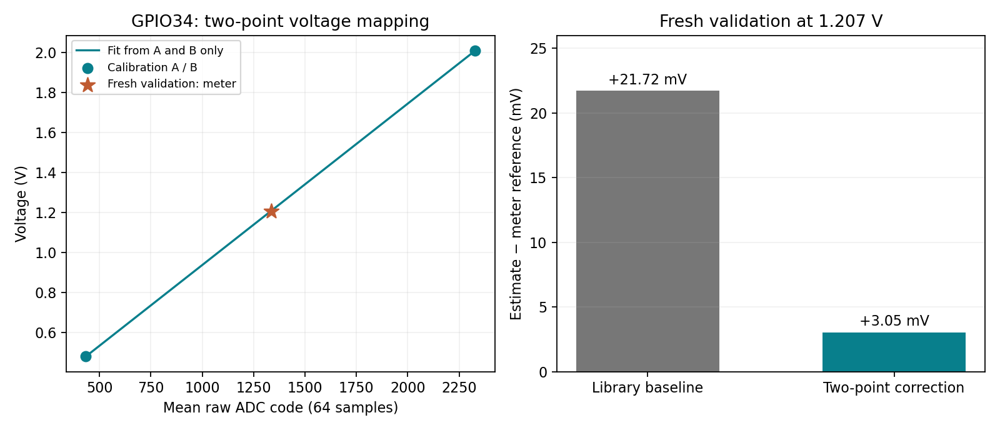

# Task 3a — ADC Chain Calibration and Validation

Date: 2026-11-10  
Status: Two-point calibration and fresh third-point validation completed. Peer comparison, meter specifications and numerical uncertainty remain pending.

## Setup

- Board: ESP32 Dev Module; Arduino IDE 2.3.10.
- ADC input: GPIO34, 12-bit resolution, 11 dB attenuation.
- Circuit requested and confirmed connected by the operator: potentiometer end terminals to 3V3 and GND; centre wiper to GPIO34 and the meter red probe; meter black probe to shared GND.
- Sketch: [task3a-adc-calibration.ino](./task3a-adc-calibration/task3a-adc-calibration.ino), compiled, uploaded and verified through live serial output.
- Port: `/dev/cu.usbserial-0001`; serial output: 115200 baud, newline-terminated commands.
- Each capture averages 64 raw ADC conversions and reports their sample standard deviation. The library voltage estimate averages a separate set of conversions at the same potentiometer position.
- Initial raw-zero readings were a setup observation and were not used as calibration data.
- Current supply voltage, meter model/range, meter specifications and potentiometer nominal resistance still need confirmation for this run. Earlier experiments' supply values are not assumed to apply.

## Model and baseline

Fit the user calibration as `V_corrected = a × raw_mean + b` from points A and B. Use a freshly measured third position for validation; do not include it in the fit.

The sketch's `factory_V` field is the voltage returned by Arduino-ESP32's `analogReadMilliVolts`, averaged over separate conversions. This library-calibrated estimate is the explicitly chosen **before-custom-calibration baseline**. It is not an independent reference or a new claim about the board's factory calibration. The multimeter supplies the reference voltage.

## Calibration record

Signed baseline error is `library_voltage − meter_reference`.

| Role | Meter reference (V) | Mean raw ADC code | Raw-code sample SD | Library voltage (V) | Baseline error (V) | Corrected voltage (V) |
|---|---:|---:|---:|---:|---:|---|
| A: calibration | 0.48200 | 433.516 | 4.408 | 0.49619 | +0.01419 | 0.48200 by construction |
| B: calibration | 2.00900 | 2328.000 | 10.432 | 2.03559 | +0.02659 | 2.00900 by construction |
| Fresh validation | 1.20700 | 1336.781 | 9.867 | 1.22872 | +0.02172 | 1.21005 |

Point A was captured with command `A 0.482` at program elapsed time 584416 ms, using N = 64. The meter reference was reported by the operator; live ADC values had moved away from zero before the capture. The capture and its reference line were shown in an Arduino IDE screenshot. Values above reproduce the printed precision; the sketch retains its internal mean for fitting.

Point B was captured with command `B 2.009` at program elapsed time 701465 ms, using N = 64. Its capture, reference and fitted equation were shown in an Arduino IDE screenshot. The board printed:

```text
V_corrected ≈ 0.000806024 × raw_mean + 0.132576
```

The slope is in volts per ADC code and the intercept is in volts. This model applies to the present GPIO34, resolution and attenuation settings over the calibrated interval, approximately 0.482–2.009 V. The intercept is an extrapolated model parameter, not a measured zero-input voltage. Reproducing the calibration points is a construction property, not independent evidence of accuracy. Use the fresh third point to assess prediction error.

## Fresh third-point validation

After fitting A and B, the operator moved the potentiometer to a new position and reported 1.207 V. Command `V 1.207` captured 64 raw readings at elapsed time 817959 ms. The validation point was not used to update the model coefficients. The output and both signed errors were shown in an Arduino IDE screenshot.

| Validation result | Value |
|---|---:|
| Meter reference | 1.20700 V |
| Library estimate before custom calibration | 1.22872 V |
| Custom two-point corrected estimate | 1.21005 V |
| Before residual: estimate minus reference | +0.02172 V |
| After residual: corrected minus reference | +0.00305 V |
| Absolute residual reduction | Approximately 86.0% |

The absolute residual is approximately 7.1 times smaller at this one validation point. This supports using the local two-point correction under the same conditions; it does not establish accuracy over the entire ADC range. The corrected residual is approximately +0.253% of the reference. Calibration-point residuals are approximately zero by construction and must not be treated as independent validation.



[Captured serial evidence](./Task3a-Captured-Serial-Evidence.txt) preserves the three accepted captures and fitted equation. It is an excerpt transcribed from observed serial output, not the complete continuous log or individual raw samples.

## Remaining checks

1. Confirm the current supply, meter model/range/specifications and potentiometer nominal value.
2. Complete numerical uncertainty if enough information is available; do not equate the residual with uncertainty.
3. Compare offset and gain with a neighbouring pod, explain which part of the chain was corrected, and record the peer's check.
4. Keep USB connected for additional tests: the current calibration points reside in RAM and are lost on reset, re-upload or power interruption. The saved record retains the coefficients, but the sketch does not persist them automatically.

## Uncertainty and limitations

The two contribution groups needing assessment are reference-meter uncertainty and ADC repeatability/noise; their ranking cannot be established without meter specifications. No numerical combined uncertainty is claimed. The raw-code standard deviations describe short captures and are not voltage accuracy. For scale only, the validation capture's 9.867-code sample SD corresponds to about 7.95 mV per conversion under the fitted slope; this does not describe uncertainty of the complete calibrated measurement. Averaging, calibration-point uncertainty, input stability, model error and meter uncertainty require separate treatment.

The meter reading must remain applicable during remote capture. Live output near validation included a brief lower reading before recovering; the cause was not established. Supply movement, contact instability and changes in attenuation or resolution invalidate an unchanged calibration assumption. One residual cannot distinguish nonlinearity from these other contributions, or establish whether the residual exceeds combined uncertainty.

## Study log and calibration decision

- What was corrected? The local mapping from this ESP32 ADC chain's raw codes to voltage, including fitted gain and offset. The potentiometer generates the input; its mechanical behaviour is not calibrated by this procedure.
- Why is the third point independent? It was freshly measured at a different position after A and B and was excluded from coefficient fitting. It shares the same reference and setup, so common systematic errors remain possible.
- Systematic versus random effects: A local gain/offset error can be corrected by the fitted mapping. Short-term code variation is observed as sample spread and can be reduced by averaging; a linear correction cannot eliminate it.
- Decision: Prefer this correction for the tested interval and unchanged acquisition settings because the fresh validation residual decreased from +21.72 to +3.05 mV. Retain the limited-range and uncertainty qualifications; wider-range or threshold-specific accuracy requires more validation.
- A and B were reproduced by the fitted equation, and the validation arithmetic was independently checked from the displayed values. LLM assistance covered the sketch, acquisition commands, calculations, documentation and plot.

Fit coefficients: `a ≈ 0.000806024 V/code`, `b ≈ 0.132576 V`, as printed by the sketch.  
Validation residual: **+0.00305 V** at the 1.207 V reference point.  
Calibration decision: Conditional local use supported by the fresh validation result; see limitations above.  
Checked by: pending peer review.
