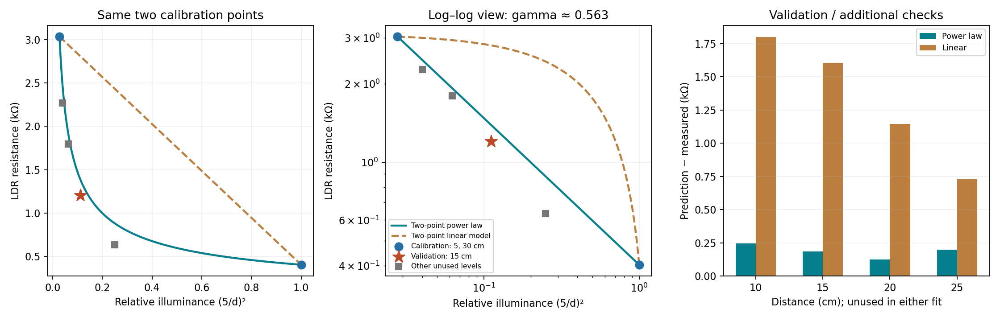

# Task 3b — LDR Two-Point Calibration and Third-Point Validation

Date: 2026-11-04. This analysis reuses the Task 1 dataset; no new hardware measurements were taken.

## Method and data roles

Circuit orientation: `3V3 → LDR → node → 10 kΩ → GND`. The measured supply is 3.35 V; the fixed resistor is treated as its nominal 10 kΩ value. The recorded voltages are across the LDR:

```text
R_LDR = 10 × V_LDR / (3.35 − V_LDR)  [kΩ]
E_relative = (5 cm / d)²
```

Relative illuminance is inferred from an inverse-square assumption, not measured lux. Calculations use unrounded resistance values.

| Role | Distance | Voltage across LDR | Relative illuminance | Calculated resistance |
|---|---:|---:|---:|---:|
| Calibration point 1 | 5 cm | 0.13 V | 1 | 0.403727 kΩ |
| Calibration point 2 | 30 cm | 0.78 V | 1/36 | 3.035019 kΩ |
| Primary validation point | 15 cm | 0.36 V | 1/9 | 1.204013 kΩ |

Both models use only the same 5 and 30 cm points. The 15 cm point is excluded from both fits. The 10, 20 and 25 cm points are additional checks, also excluded from fitting. These roles were selected before this calculation.

## Power-law model

```text
R = A × E_relative^(−γ)
ln R = ln A − γ ln E_relative
γ = −ln(R30/R5) / ln(E30/E5) ≈ 0.562920
A = R5 / E5^(−γ) ≈ 0.403727 kΩ

Final model: R ≈ 0.403727 × E_relative^(−0.562920) kΩ
```

## Linear model

The linear model fits resistance against relative illuminance, not distance:

```text
R = m × E_relative + b
m = (R30 − R5) / (E30 − E5) ≈ −2.706473 kΩ
b ≈ 3.110199 kΩ

Final model: R ≈ −2.706473 × E_relative + 3.110199 kΩ
```

## Third-point validation at 15 cm

Signed error is defined as prediction minus resistance calculated from the measured voltage. Relative error uses that calculated resistance as its denominator.

| Model | Measured-derived resistance | Predicted resistance | Signed error | Relative error |
|---|---:|---:|---:|---:|
| Two-point power law | 1.204 kΩ | 1.391 kΩ | +0.187 kΩ | +15.5% |
| Two-point linear | 1.204 kΩ | 2.809 kΩ | +1.605 kΩ | +133.3% |

The power-law absolute error is approximately 8.6 times smaller at this point, but its remaining 15.5% overprediction prevents a claim of accurate calibration.

## Additional points excluded from fitting

| Distance | Power-law relative error | Linear relative error |
|---:|---:|---:|
| 10 cm | +38.8% | +283.3% |
| 20 cm | +7.1% | +63.8% |
| 25 cm | +8.8% | +32.2% |

These checks also favour the power law over a single straight line across this range. Model error depends on light level; the 10 cm power-law error remains substantial.



## Interpretation and calibration decision

LDR resistance is nonlinear with illumination and approximately linear in log–log coordinates. Both two-parameter models pass exactly through the two calibration points. Zero calibration-point residuals do not establish validity; excluded points distinguish the models. The power law performs better at every excluded point in this dataset.

Select the power law as a provisional relative-light model within the measured range. Reject the fitted straight line for prediction across this range. No model has been deployed to the ESP32, and no absolute lux calibration has been established. Ambient light, source directionality, distance and angle control, and departures from inverse-square behaviour may contribute to error; this dataset cannot identify their individual contributions.

## Validation-point uncertainty statement

**Uncertainty has not yet been quantified. Two contribution groups needing assessment are relative-light estimation (distance, directionality and ambient light) and resistance calculation (multimeter accuracy and fixed-resistor tolerance). Available data cannot establish which dominates or support a credible numerical U.**

The 15.5% result is a model-validation error, not measurement uncertainty. It must not be reported as a verified “1.204 kΩ ±15.5%” uncertainty statement. Actual fixed resistance, meter specifications, distance uncertainty and repeated readings remain unavailable.

## Scope of validation independence

The 15 cm point is outside the current parameter fit, so it provides a held-out third-point check. It was previously inspected in Task 1 and is not a fresh blind measurement or an independent experimental run. It shares the supply, meter, nominal resistor and light-estimation assumptions with the calibration points, so common systematic errors may remain undetected. State this during peer review and, when equipment is available, check a newly measured light level under the same source conditions.

## Study log and mini checks

- Main understanding: Perfect agreement at calibration points does not prove calibration success; validation can expose model-selection error.
- Why choose a power law? With the same endpoints and validation point, it predicts substantially better than the linear model, although further validation is needed.
- Which error concerns the model? A straight line across a nonlinear R–E relationship introduces systematic prediction errors. Repeated measurements are needed to quantify random variation; this dataset lacks them.
- LLM assistance: Formula preparation, model calculation, validation errors and plots. Resistance was recalculated from the original voltages and both models were checked against their calibration points. Fresh measurements and peer review remain pending.
- Source: [Module 3 — Task 3b](https://github.com/iotempire/iotempire-teaching/blob/main/full-classes/hsbi-sensors-actuators-10d/modules/03-sensor-characterization-and-calibration.md).

## Evidence

- [Models and validation plot](./Task3b-LDR-Models-and-Validation.png)
- [Calculation table](./Task3b-LDR-Calibration-and-Validation.csv)
- [Task 1 lab record](./Task1-LDR-Lab-Record.md)

Analysis of the available data is complete. Numerical uncertainty and a fresh validation measurement can be added when equipment is available.

## Requirements review — 2026-11-10

The current module explicitly requires a fresh validation measurement in the calibration record and a neighbouring pod's check. The existing held-out 15 cm calculation remains useful preliminary evidence, but it reuses an earlier measurement. Task 3b is therefore partially complete against the current requirements: collect a fresh validation point under the same controlled conditions as its calibration points, complete the specified calibration-record table and uncertainty line, and obtain peer review. The later 15 cm repeatability set used changed ambient light and must not be substituted into the original calibration as if conditions were unchanged.
