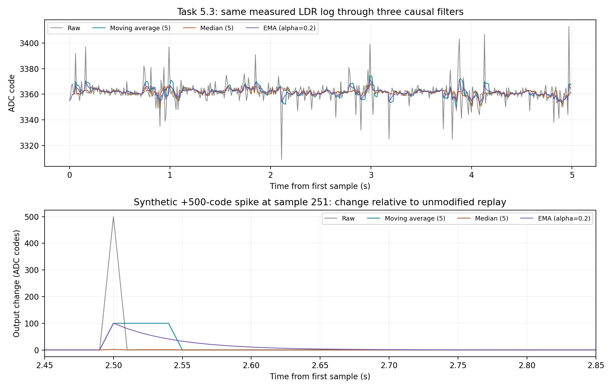

# Task 5.3 — LDR filter and single-spike comparison

Date: 2026-11-10. Offline analysis of the unchanged 500-sample [Task 5.2 LDR log](./Task5.2-LDR-Run1-Raw-Samples.txt). No additional physical acquisition was performed. All original measured data remain unchanged.

## Reproducible method

Replay each raw sample through a trailing 5-sample arithmetic mean, a trailing 5-sample median, and an exponential moving average y[n] = 0.2 x[n] + 0.8 y[n−1]. The EMA starts at the first raw value. No future samples, detrending, outlier rejection or voltage conversion are used. MA5 and median5 are undefined (NaN) for the first four samples rather than using shortened startup windows.

For a fair standard-deviation comparison, use the same sample indices 26–500 (475 points) for all four signals. Exclude the first 25 samples to reduce EMA startup effects; the table does not compare a shortened filter output against the full raw log. The full raw 500-point SD in Task 5.2 is 8.419693 codes; the raw SD below uses only the shared comparison window. Sample standard deviations use n−1.

## Measured-log replay

| Signal | Sample SD (ADC codes), samples 26–500 | SD reduction relative to raw |
| --- | ---: | ---: |
| Raw | 8.327396 | 0.00% |
| Moving average (5) | 3.642835 | 56.25% |
| Median (5) | 2.477914 | 70.24% |
| EMA (alpha=0.2) | 2.675957 | 67.87% |

These reductions describe variability of this recorded LDR chain under nominally fixed illumination; they do not establish improved absolute accuracy or identify intrinsic sensor noise. The median is particularly effective on isolated excursions in this log. A different noise distribution can change this ranking.

## Synthetic single-sample outlier

Create a separate copy of the raw log and add exactly +500 codes to sample 251 at 2.500024 s. Its original value is 3360, and its synthetic value is 3860. This is an artificial replay experiment, not an observed light pulse or a new physical measurement. No clipping is applied. Run the same filters with identical initialization. Subtract each unmodified replay from its modified replay to isolate the spike's effect from the measured background.

- Raw: a +500-code change for one sample.
- MA5: a +100-code change for five samples (251–255), then zero change. The outlier is spread across the averaging window.
- EMA: an initial +100-code change at sample 251, then 100 × 0.8^k codes after k subsequent samples. It spreads the effect into a decaying tail.
- Median5: maximum absolute output change of 2 codes for this replay. The exact result depends on the surrounding measured sample values; robustness does not imply a universal zero response.

## Lag trade-off and decision

Smoothing reduces sample-to-sample variation but delays the response to real changes; median filtering additionally rejects isolated spikes while potentially suppressing very brief real events. MA5 has a theoretical group delay of two samples (approximately 20 ms at 100 Hz). This fixed-light dataset does not measure step latency. The separate [potentiometer Run 4](./Task5.4-Potentiometer-Step-Lab-Record.md#repeat--run-4-qualified-delay-measurement) provides qualified 50%-crossing delays of 20 ms (MA5), 20 ms (median5) and 40 ms (EMA) for its finite-speed manual transition; those values are not universal filter delays.

For a frost alarm, combine a noise-appropriate filter with hysteresis in the threshold decision; a low SD alone is insufficient to select a safe alarm response. Task 5.5 still requires a recorded slow sensor drift through the decision thresholds.

Task 5.3 is complete as an LDR-log replay comparison, with synthetic data clearly separated from the original measurements. [All original-input, filtered and synthetic-replay columns](./Task5.3-LDR-Filtered-Samples.txt) are retained for inspection.
