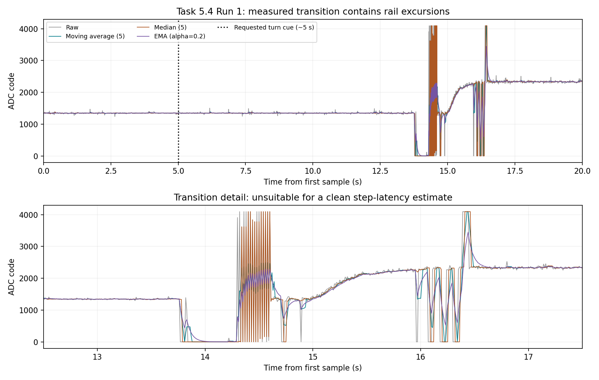
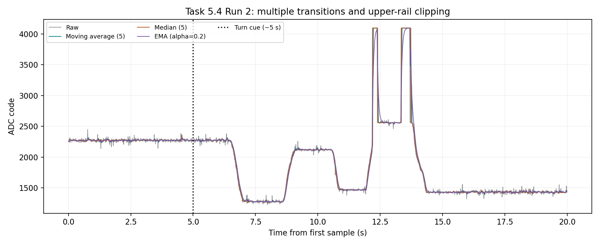
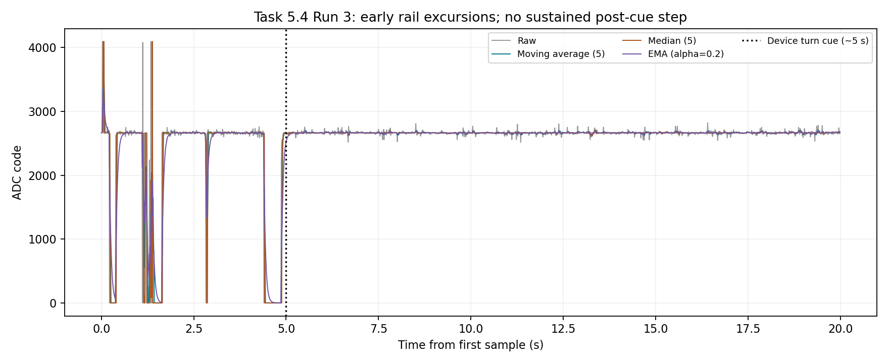
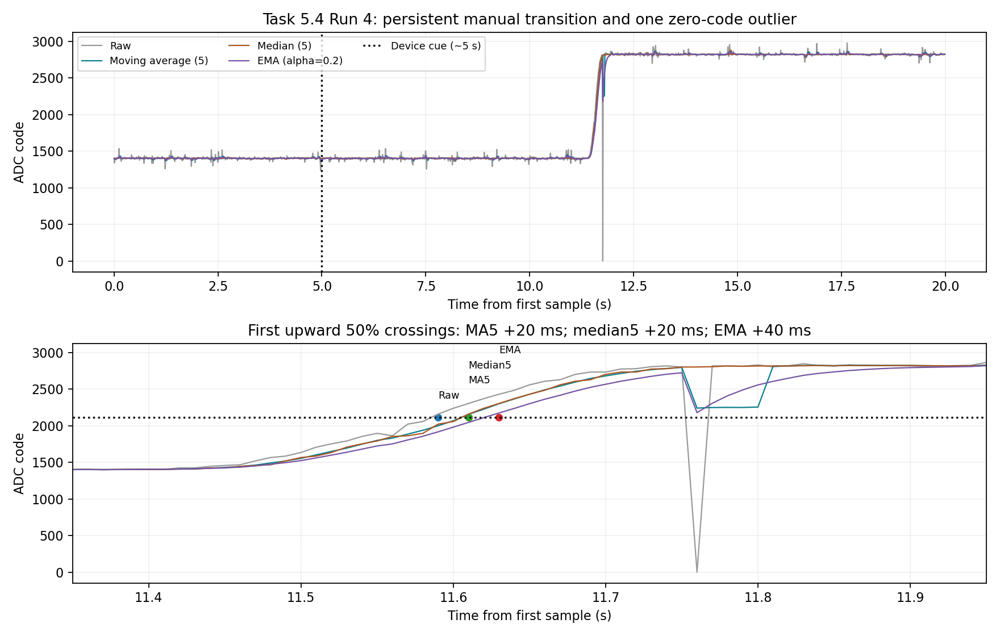

# Task 5.4 — Potentiometer Step Run 1

Date: 2026-11-10

Status: acquisition saved and verified; clean step-latency measurement remains incomplete.

## Acquisition and validation

The user was asked to hold the initial knob position, turn once quickly on `TURN NOW`, and then hold until `DONE`. The Arduino received `S` and captured 2000 samples using GPIO34, 12-bit resolution and 11 dB attenuation. The recorded command start was 20:28:15.162 in the desktop Serial Monitor. Its later output timestamps describe serial printing, not individual sampling times. No simultaneous reference-voltage reading was provided.

All 2000 sequential indices and increasing acquisition timestamps were verified. The acquisition span was 19.990024 s. Sample intervals ranged from 10000 to 10024 µs; mean interval was 10000.012 µs. The three exported filters were independently recomputed and agree to 0.000001 code absolute tolerance. They are causal trailing five-point moving average and median, and EMA with alpha 0.2 initialized at the first sample. Window outputs are undefined for the first four samples. Filters were replayed after raw acquisition; CPU execution latency was not measured.

## Observations

- Initial plateau, 1–12 s: mean 1346.763, sample SD 15.370 raw codes.
- Final plateau, 17–20 s: mean 2334.870, sample SD 28.623 raw codes.
- Requested turn cue: approximately 5 s. The main recorded disturbances occur approximately 13–17 s; the cue is not the electrical step time.
- Samples at the lower rail (0): 82; at the upper rail (4095): 18. These are retained in all saved data.
- The transition includes repeated large reversals and both-rail excursions rather than one clean step. This may involve movement/contact or other electrical disturbances, but the trace alone does not establish their cause.

## Interpretation

A single 50% threshold crossing in this disturbed transition would not reliably characterize filter delay. No measured latency is reported. Filtering can smooth the excursions, but that does not turn them into a valid input step. The theoretical moving-average group delay of two samples (about 20 ms) remains a prediction, not a result of this run.

For the repeat, secure the breadboard connections and potentiometer terminals. Keep both knob positions away from the ends of travel. Use a smaller, quick turn between two clear intermediate levels, touching only the shaft and leaving the leads still. Hold each level long enough to establish its plateau. A clean repeat is needed to complete Task 5.4.

## Evidence

- [Original serial log](./Task5.4-Potentiometer-Step-Run1-Serial-Log.txt)
- [All 2000 samples and firmware filter outputs](./Task5.4-Potentiometer-Step-Run1-Samples.txt)
- [Acquisition sketch](./task5-step-acquisition/task5-step-acquisition.ino)
- [Protocol](./Task5.4-Potentiometer-Step-Protocol.md)

## Repeat — Run 2

Date: 2026-11-10. A new capture was started with `S` at desktop Serial Monitor time 20:31:14.413. The user was instructed to turn only once by a small amount and then hold. The turn cue appeared at 20:31:19.758. The complete output ended at 20:31:42.840, after acquisition and buffered printing. This run is stored separately from Run 1.

TextEdit became unresponsive during export. The Serial Monitor output was copied through an Arduino IDE scratch editor, saved as an intermediate text-containing sketch without compiling or uploading it, and then copied byte-for-byte into the final `.txt` serial log. This fallback did not start another capture or change the firmware. The final log contains one complete acquisition block.

Exactly 2000 sequential indices and increasing timestamps were verified; all three filter columns independently match recomputation to 0.000001 code. Acquisition span: 19.990027 s. Intervals: minimum 10000, maximum 10027, mean 10000.014 µs. All raw data are retained.

The initial 0–5 s mean is 2272.844 codes. The final 15–20 s mean is 1432.468 codes. There are no samples at 0 and 58 samples at 4095. The trace changes downward near 6–7 s, upward near 8–9 s, downward again near 10–11 s, reaches the upper rail during 12–14 s, and then returns to a lower plateau. The cause cannot be established from the log; actual knob motion, contacts and input voltage were not independently observed.

This is not one clean intermediate-level step. A single crossing-delay result would be ambiguous and is not reported. Task 5.4 remains incomplete. Before another repeat, confirm whether the operator made more than one turn and check that holding or gently turning the shaft does not disturb the connections. Keep both levels away from the rails and use one small, quick movement followed by a fixed hold.

- [Run 2 original exported log](./Task5.4-Potentiometer-Step-Run2-Serial-Log.txt)
- [Run 2 complete samples and filter outputs](./Task5.4-Potentiometer-Step-Run2-Samples.txt)

## Repeat — Run 3

Date: 2026-11-10. Serial Monitor start message: 22:16:35.938; device turn cue: 22:16:41.265; final DONE message: 22:17:04.270. Desktop message times include transport and printing delays and are not sample times. The operator was instructed to turn once by a small amount and then hold; actual motion was not independently observed. Output was exported through an Arduino scratch editor without compiling or uploading the export.

All 2000 sequential samples were retained. Acquisition span: 19.990024 s. Sample interval minimum/maximum/mean: 10000 / 10024 / 10000.012 microseconds. All three filter columns independently match recomputation within 0.000001 ADC code.

There are 106 samples at 0 and 6 at 4095. Large excursions occur before approximately 5 s. The 5–10 s mean is 2664.960 codes; the 15–20 s mean is 2665.984 codes. No sustained change between distinct levels follows the device cue. The record does not establish the cause; wiring/contact problems and actual shaft motion need to be checked physically. A single-step filter latency cannot be determined from this run. Task 5.4 remains incomplete.

- [Original exported serial log](./Task5.4-Potentiometer-Step-Run3-Serial-Log.txt)
- [All samples and filter outputs](./Task5.4-Potentiometer-Step-Run3-Samples.txt)

Before another timed capture, verify that a fixed knob position produces a steady intermediate reading and that turning the shaft produces a repeatable, persistent change. Check the wiper-to-GPIO34 connection, both outer terminals to 3V3/GND, and exposed contacts. Only start another step capture after this check passes.

## Repeat — Run 4: qualified delay measurement

Date: 2026-11-10. Serial Monitor START time 22:33:36.375; final DONE time 22:34:04.779. These desktop times include buffering and printing and are not used for latency. The device cue occurs at approximately 5 s; the main observed transition is near 11.4–11.7 s. Operator reaction time is excluded by comparing filtered crossings with the raw crossing. Export used a scratch Arduino editor without compiling or uploading it.

All 2000 sequential samples and increasing timestamps were verified. Span: 19.990027 s; interval min/max/mean: 10000/10027/10000.014 microseconds. All filter outputs match independent causal recomputation to 0.000001 code.

The pre-transition mean over 2–10 s is 1401.9825 codes; the post-transition mean over 13–20 s is 2822.6400 codes. Their midpoint is 2112.31125 codes. The first upward crossing after 10 s is used for each signal, without interpolation or removing samples.

| Signal | First crossing sample (1-based) | Time from first sample (s) | Delay relative to raw (ms) |
| --- | ---: | ---: | ---: |
| Raw | 1160 | 11.590027 | 0 |
| Moving average (5) | 1162 | 11.610027 | 20 |
| Median (5) | 1162 | 11.610027 | 20 |
| EMA (alpha=0.2) | 1164 | 11.630027 | 40 |

The moving-average group delay is (5-1)/2 = 2 samples, approximately 20 ms, consistent with the measured crossing difference. The median's 20 ms result applies to this transition and is not a general linear group delay. The EMA's 40 ms result is an empirical crossing delay for this finite-speed manual transition, not its ideal instantaneous-step response or a universal delay. At a 10 ms sampling interval these are discrete estimates; crossing-time quantization and noise limit precision. Raw first-crossing 10–90% rise time is 200 ms, so this input is a manual ramp-like transition rather than an ideal step.

One raw sample (1177 at 11.760027 s) is 0; none is 4095. The zero occurs after all initial 50% crossings. It is retained and causes a later disturbance in MA5 and EMA; median5 rejects this isolated low outlier. Its physical cause is unknown. No ideal-step settling time is claimed. A cleaner repeat could improve the evidence, but this run supports a qualified comparison of filter lag.

- [Original serial export](./Task5.4-Potentiometer-Step-Run4-Serial-Log.txt)
- [Complete samples and filters](./Task5.4-Potentiometer-Step-Run4-Samples.txt)

Task 5.4 now has measured crossing-delay evidence, with the finite-speed input and single zero-code outlier explicitly documented. Runs 1–3 remain preserved as unsuccessful attempts.
