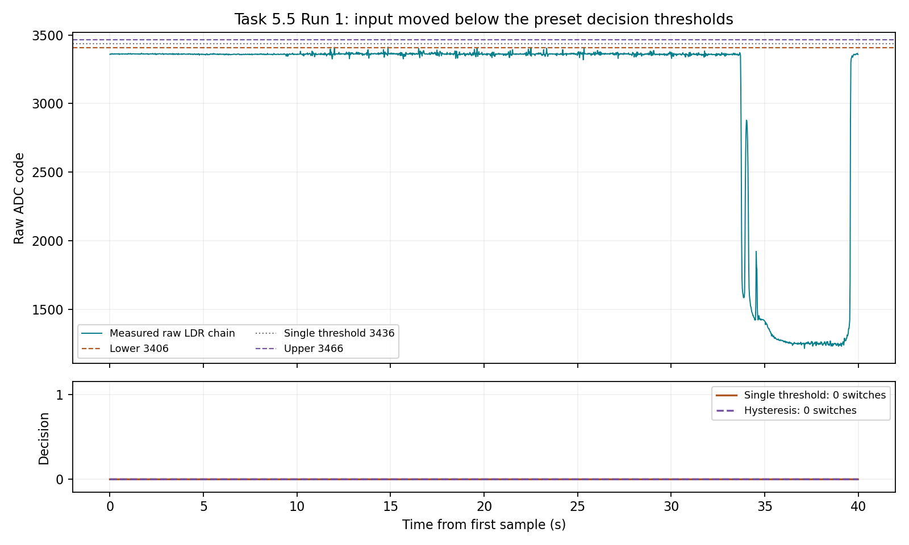
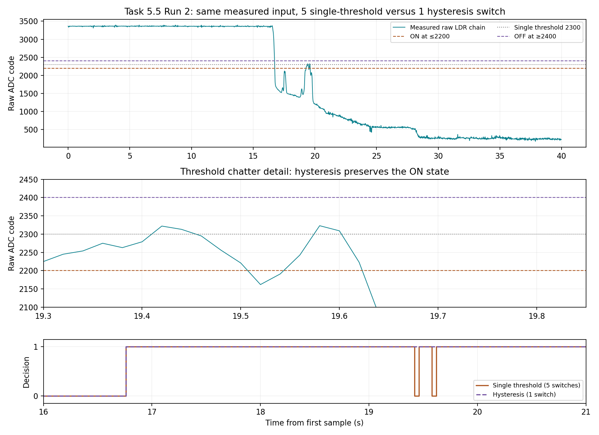

# Task 5.5 — LDR threshold decision with hysteresis

Date: 2026-11-10. Status: Run 2 demonstrates reduced threshold chatter with hysteresis; a full return/reset cycle was not captured. Run 1 remains preserved.

## Setup and measured baseline

The existing Task 5.2 divider is retained: 3V3 → 10 kΩ → GPIO34 junction → LDR → GND, as reported by the operator. With this orientation, shading is expected to increase the ADC code. Physical wiring has not been independently reverified.

The [experiment sketch](./task5-ldr-hysteresis/task5-ldr-hysteresis.ino) was compiled and uploaded through Arduino IDE. GPIO34, 12-bit resolution, 11 dB attenuation. Sending B discards 32 warm-up readings then takes 200 readings, separated by approximately 10 ms. These baseline samples are summarized by the firmware but are not exported individually.

Observed Serial Monitor output at 22:58:03.719:

```text
BASELINE mean=3356.165,min=3302,max=3399,lower=3406,midpoint=3436,upper=3466
READY. S captures 40 s. Slowly shade then uncover. B repeats baseline.
```

Thresholds use the rounded baseline plus 50, 80 and 110 ADC codes respectively. These are demonstration thresholds for light level, not calibrated illuminance or temperature thresholds.

## Planned acquisition and analysis

S starts 2000 raw samples at a target 50 Hz (40 s), buffered before printing. The intended input is slow partial shading, a pause near the threshold, followed by slow uncovering, with wiring and light source kept still. The same raw sequence is evaluated by both decisions after sampling:

- Single threshold: state = 1 when raw ≥ 3436, otherwise 0.
- Hysteresis: initial state 0; switch to 1 when raw ≥ 3466; switch to 0 when raw ≤ 3406; preserve the previous state inside the band.

The firmware applies decisions during buffered replay and exports raw samples, acquisition timestamps and both decision states. It does not drive a physical alarm or measure real-time actuator latency. Count state transitions including any change from the initial state 0, independently verify both output columns, and plot the input and thresholds above the decisions. Report observed chatter reduction only if the acquired data demonstrate it. Do not claim a slow-threshold crossing until a valid sensor drift has been recorded.

For the frost-alarm discussion, the light demonstration establishes the decision principle only. A temperature implementation would turn an alarm on below its lower temperature threshold and clear it above the upper threshold; the numeric light thresholds cannot be transferred to degrees Celsius.


## Run 1 — acquisition and validity

Serial START 22:59:27.264; DONE 23:00:11.106. Operator instructions were: initially leave the LDR uncovered, gradually increase shading, pause, then gradually uncover. Actual hand motion, illumination and wiring were not independently observed. Serial output was preserved via a scratch Arduino editor without uploading that export.

Verified exactly 2000 sequential sample indices, strictly increasing acquisition timestamps, and both decision columns by independent recomputation. Span 39.980011 s; sampling interval min/max/mean 20000/20011/20000.006 microseconds. Raw minimum/maximum: 1216/3411; zero samples at either ADC rail. The first 30 seconds stay mostly near 3360 codes; a large downward excursion occurs late in the capture, followed by recovery. The log alone does not establish whether this reflects shading direction, another change in illumination, wiring orientation, or timing of the operator's actions.

Neither decision ever became 1: single-threshold state changes = 0; hysteresis state changes = 0, including transitions from the initial state 0. The raw maximum (3411) is below the single threshold (3436) and upper hysteresis threshold (3466). A few samples may enter the band above the lower threshold, but cannot turn the initially off hysteresis decision on. Therefore this run does not demonstrate hysteresis suppression of threshold chatter or a full crossing of both decision thresholds. Task 5.5 remains incomplete. Thresholds are not retrospectively changed to present this as a successful preconfigured test.



Before repeating, check the sensor's response direction with intentional covered/uncovered states and verify the divider connections. Choose thresholds between those measured states with room for a slow crossing in both directions. Preserve this unsuccessful attempt separately. For a high-code alarm, turn on at the upper bound and off at the lower bound; for a low-code alarm, reverse those state rules. This is a decision-state hysteresis test, not a sensor calibration.

- [Original serial log](./Task5.5-LDR-Run1-Serial-Log.txt)
- [All raw samples and both decision outputs](./Task5.5-LDR-Run1-Samples.txt)


## Run 2 — corrected preselected thresholds and observed chatter reduction

Date: 2026-11-10. A separate [Run 2 firmware](./task5-ldr-hysteresis-run2/task5-ldr-hysteresis-run2.ino) was compiled and uploaded. Based on the range observed in Run 1, thresholds were fixed before the new capture at lower=2200, midpoint=2300 and upper=2400 ADC codes. The comparison uses a low-code alarm: single threshold ON at raw ≤2300; hysteresis ON at raw ≤2200, OFF at raw ≥2400, retaining its prior state between those thresholds. Both start OFF. These thresholds are selected for a light demonstration and have no degree-Celsius interpretation.

The new 200-sample baseline summary was mean 3354.415, minimum 3313, maximum 3408; individual baseline samples were not exported. Serial START: 23:05:30.876; DONE: 23:06:14.634. The operator was prompted to hold uncovered, gradually shade, pause and gradually uncover; actual hand position was not independently recorded. The captured trace did not follow a complete return-to-baseline cycle.

All 2000 sequential sample indices and increasing timestamps were verified. Span 39.980007 s; interval min/max/mean 19999/20008/20000.004 microseconds. Raw minimum/maximum 176/3394; no samples at 0 or 4095. Both decision columns exactly match independent causal replay of the raw input with the recorded thresholds and initial states. Serial output was saved through a scratch Arduino editor without compiling or uploading that export.

### Observed result

The input begins near 3360 codes, changes downward after approximately 16 s, and exhibits a slower downward trend with fluctuations and some abrupt changes. It is a manually varied input, not a controlled linear drift. Near 19.4–19.6 s it repeatedly crosses the single threshold at 2300 while remaining within the hysteresis band. The single-threshold decision switches 5 times; hysteresis switches once and retains ON. Counts include any initial transition from OFF.

| Sample | Time from first sample (s) | Raw ADC code | Single-threshold state | Hysteresis state |
| --- | ---: | ---: | ---: | ---: |
| 839 | 16.760007 | 2044 | 1 | 1 |
| 972 | 19.420007 | 2322 | 0 | 1 |
| 974 | 19.460007 | 2295 | 1 | 1 |
| 980 | 19.580007 | 2323 | 0 | 1 |
| 982 | 19.620007 | 2223 | 1 | 1 |

Four additional single-threshold transitions (two brief OFF/ON pairs) are avoided by hysteresis in this trace. This is observed chatter reduction on the same measured input, not a guarantee of an 80% reduction for future conditions. At the first recorded trigger both thresholds were crossed within one sample interval, so both decisions turn ON at 16.760007 s; a separate hysteresis activation delay cannot be resolved from this event. No filter was applied to the signal before either decision.



### Limits and frost-alarm recommendation

At the end of the capture the signal remains near 230 codes and both decisions are ON. It never reaches the upper reset threshold after triggering. The OFF/reset branch and a complete hysteresis loop therefore have not been demonstrated experimentally. A supplementary slow return through 2400 would strengthen the evidence. Physical divider orientation and the cause of the observed response direction remain unverified; do not assert that this low-code event corresponds to darkness without checking covered/uncovered states.

For a temperature frost alarm, I would use hysteresis in the decision, with an ON threshold at the required low-temperature alarm point and a higher OFF threshold to prevent repeated toggling. Select the band from temperature noise, measurement uncertainty and operating requirements, rather than copying these ADC thresholds. Filtering may suppress isolated excursions, but its lag must be included in the response requirement. Hysteresis adds state memory and requires more recovery before clearing; it does not average the measured signal or correct calibration error. This light experiment supports the decision principle, not validated performance at 2 °C.

Task 5.5 now has qualified evidence of hysteresis suppressing repeated switching during a measured threshold fluctuation, plus the alarm recommendation. Full return/reset evidence remains an explicitly identified limitation.

- [Run 2 original serial log](./Task5.5-LDR-Run2-Serial-Log.txt)
- [Run 2 complete raw and decision samples](./Task5.5-LDR-Run2-Samples.txt)
