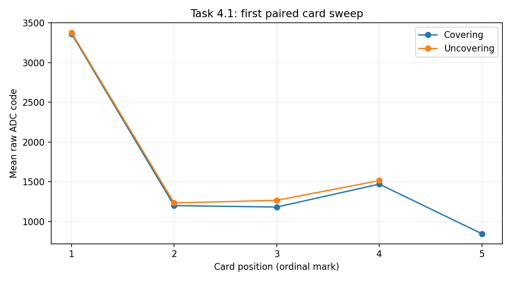

# Task 4.1 — First paired LDR card sweep

Date: 2026-11-10. Status: first stepped sweep recorded.

The operator moved the card through positions 1–5 and back through 4–1. Position 5 is the shared turnaround. After each position was confirmed, the ESP32 acquired 100 samples at 20 ms intervals on GPIO34. The card position is an ordinal proxy for illumination. Lamp and sensor were to be kept fixed. No independent illuminance reading was recorded. Raw ADC and library millivolts come from separate consecutive conversions.

The export contains nine complete 100-row blocks with sequential sample indices and increasing within-block timestamps. The first block's serial header is corrupted by repeated text. Its data rows match the separately saved position-1 export and its position follows the operator-confirmed capture order. The original export preserves the corrupted header.

| Card position | Covering ADC mean | Covering mean mV | Uncovering ADC mean | Uncovering mean mV | ADC difference (return − outward) |
| --- | ---: | ---: | ---: | ---: | ---: |
| 1 | 3361.42 | 2791.35 | 3375.49 | 2799.23 | +14.07 |
| 2 | 1200.05 | 1117.31 | 1233.58 | 1145.30 | +33.53 |
| 3 | 1182.28 | 1090.98 | 1267.01 | 1172.09 | +84.73 |
| 4 | 1470.05 | 1336.24 | 1514.53 | 1373.51 | +44.48 |
| 5 | 846.61 | 828.69 | — | — | — |

The maximum absolute paired difference is 84.73 ADC codes at position 3. Position 5 has a single measurement. The nonmonotonic sequence across some marks limits the interpretation of position as a light proxy. This result measures a directional difference in the recorded divider output. Card placement, uncontrolled timing, illumination and sensor history remain possible contributors. A confirmed divider orientation and supply measurement are needed to report resistance in ohms from the voltage readings. Two controlled sweep speeds and a settling comparison remain pending.

[Extracted samples](evidence/samples.csv) · [Original serial export](evidence/serial-export.txt)
