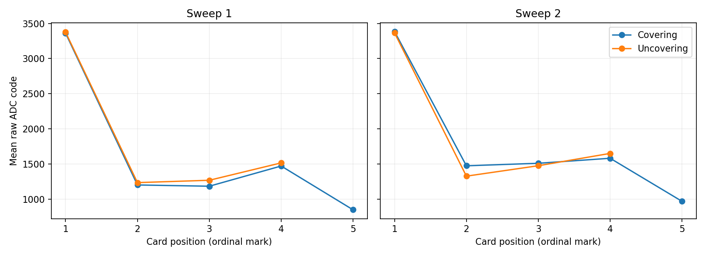

# Task 4.1 — Second paired LDR card sweep

Date: 2026-11-10. Acquisition order was 1, 2, 2, 3, 4, 5, 4, 3, 2, 1. All ten 100-sample blocks were verified and preserved. The operator selected the second outward position-2 capture. The first is marked excluded in the data. Nine blocks (900 samples) contribute to the sweep, with position 5 serving as the shared turnaround.

| Card mark | Sweep 2 outward ADC mean | Sweep 2 return ADC mean | Sweep 2 return − outward | Sweep 1 return − outward |
| --- | ---: | ---: | ---: | ---: |
| 1 | 3385.04 | 3366.03 | -19.01 | +14.07 |
| 2 | 1473.03 | 1325.63 | -147.40 | +33.53 |
| 3 | 1508.93 | 1474.10 | -34.83 | +84.73 |
| 4 | 1580.37 | 1649.56 | +69.19 | +44.48 |

Sweep 2's maximum absolute difference is 147.40 ADC codes at mark 2. Sweep 1's maximum was 84.73 codes. The time from the start at mark 5 to the first return capture was 119.142 s. The capture intervals reflect command timing and include a long turnaround. Actual card travel speeds were not recorded. The marks provide an ordinal illumination proxy. These differences cannot isolate light history, response lag or physical hysteresis. The report uses ADC codes because divider orientation and supply voltage were not independently measured for this experiment.

[Samples and inclusion flags](evidence/samples.csv) · [Serial export](evidence/serial-export.txt) · [First sweep](../sweep-1/README.md)
