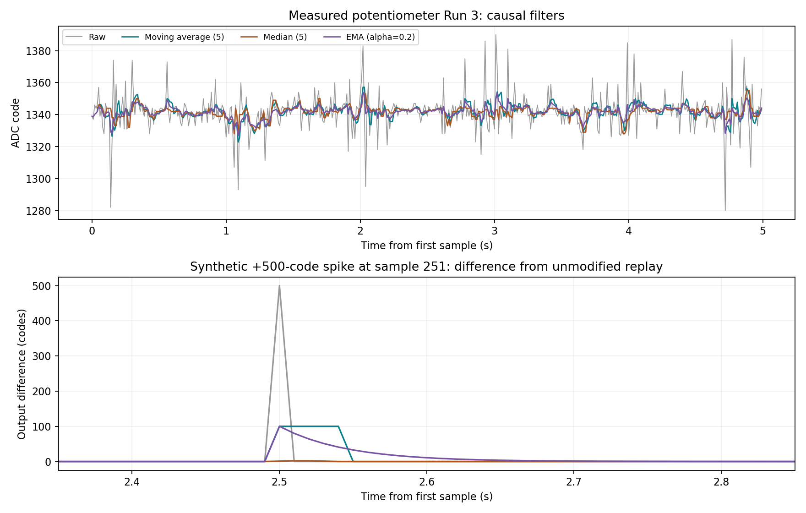

# Task 5.3 — Potentiometer Filter Rehearsal

Date: 2026-11-10

## Scope and provenance

This is an offline replay of the measured 500-sample potentiometer Run 3. No new hardware acquisition occurred. The course specifies an LDR log for Task 5.3; this rehearsal demonstrates the methods, but the formal LDR comparison was completed later and is recorded separately in [Task 5.3 LDR results](README.md). Original raw files are unchanged.

## Reproducible method

- Five-sample moving average: mean of the current and previous four raw values.
- Five-sample median: median of the same trailing window.
- EMA: y[i] = 0.2*x[i] + 0.8*y[i-1], initialized with y[0] = x[0].
- All filters are causal, using no future samples. The first four moving-window outputs are undefined (`nan`), not padded with zeros.
- All 500 inputs are exported. Statistics use the same samples 26–500 (475 points) for every method, excluding an explicitly declared 25-sample initialization interval. This is not an outlier exclusion. The raw SD in this table therefore differs slightly from the all-500-point SD in Task 5.1.
- Calculations retain floating-point outputs. Fractional codes after filtering are arithmetic results, not evidence of improved absolute accuracy.
- Synthetic test: add exactly +500 codes to sample 251 only, retaining the measured background. This is artificial data, not a measured electrical event. The modified input stays within the 12-bit code range.
- Replay both the original and modified series. Subtract each original filter output from its modified counterpart to isolate the spike's effect from background fluctuations.

## Results

| Method | Mean (codes) | Sample SD (codes) | SD reduction | Maximum spike effect (codes) |
|---|---:|---:|---:|---:|
| Raw | 1341.905 | 10.987 | 0.0% | 500.000 |
| Moving average (5) | 1341.871 | 4.700 | 57.2% | 100.000 |
| Median (5) | 1341.669 | 3.761 | 65.8% | 2.000 |
| EMA (alpha=0.2) | 1341.867 | 3.499 | 68.2% | 100.000 |

## Findings and limits

The moving average and EMA both spread the added spike: the moving average adds exactly 100 codes to five consecutive outputs; the EMA initially adds 100 codes and then decays by a factor of 0.8 per sample. The median's response depends on the local measured window: it rejects the large spike but may change slightly because the ranking of the window values changes. All methods reduce the observed sample SD for this dataset. A lower SD does not remove calibration bias or prove better absolute accuracy.

For a five-sample moving average, the linear-phase group delay is two samples, approximately 20 ms at 100 Hz. This is an analytical property, not a measured Task 5.4 step delay. Median and EMA step behaviour must be evaluated on the upcoming potentiometer step acquisition; no measured latency is claimed here.

For isolated impulsive disturbances, the median is a useful candidate. Moving average and EMA smooth fluctuations but smear a spike and delay changes. The choice for the LDR requires the LDR dataset. A filter cannot repair an intermittent connection.

## Evidence and remaining work

- [Source: all 500 measured Run 3 inputs](../potentiometer-noise/evidence/Task5.1-Potentiometer-Run3-Raw-Samples.txt)
- [Original and synthetic filtered outputs](evidence/Task5.3-Potentiometer-Filtered-Samples.txt)
- [Filter comparison plot](evidence/Task5.3-Potentiometer-Filter-Comparison.png)
- [Course task](https://github.com/iotempire/iotempire-teaching/blob/main/full-classes/hsbi-sensors-actuators-10d/modules/03-sensor-characterization-and-calibration.md)

Task 5.3 remains partial until these methods are applied to the fixed-illumination LDR acquisition. Task 5.4 still needs a measured potentiometer step. Task 5.5 specifies an LDR or DS18B20 decision; a potentiometer demonstration alone would be a rehearsal.
