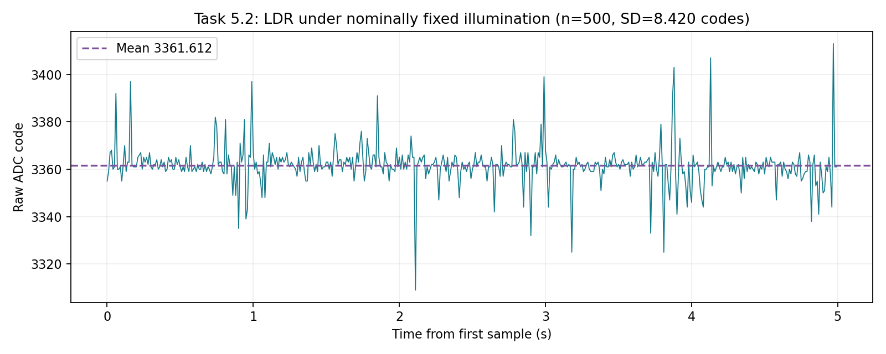

# Task 5.2 — LDR noise under fixed illumination

Date: 2026-11-10.

## Setup and method

The operator reported completing the illustrated divider: ESP32 3V3 → 10 kΩ fixed resistor → junction shared with GPIO34 → LDR → GND. Wiring and resistor value were not independently verified from a new photograph or meter reading. The operator was instructed to keep illumination, light source, sensor position and hand position fixed. No illuminance reference, lamp distance, or simultaneous voltage reading was recorded. The 3.30 V used in the preceding illustration was an ideal model, not a measured supply for this run.

The dedicated [LDR sketch](firmware/task5-ldr-noise-acquisition/task5-ldr-noise-acquisition.ino) was compiled and uploaded with Arduino IDE. ESP32 GPIO34, 12-bit resolution and 11 dB attenuation match the potentiometer acquisition settings. Sending S starts 32 discarded warm-up conversions followed by 500 single raw conversions at a target 100 Hz. Raw data and microsecond acquisition timestamps are buffered before serial output; no filtering, detrending, rejection or correction is applied. Serial START: 22:51:49.978; DONE: 22:51:56.012. Desktop times include printing and are not sampling timestamps.

The full serial output was copied via a scratch Arduino editor, saved without compiling or uploading that export, then preserved in a text log. All 500 sequential sample indices and increasing timestamps were verified. Offline mean and sample standard deviation agree with the firmware summary within 0.000001 code.

## Results

| Quantity | Result |
| --- | ---: |
| Samples | 500 |
| Mean ADC code | 3361.612000 |
| Sample standard deviation (n−1) | 8.419693 codes |
| Minimum / maximum | 3309 / 3413 |
| Peak-to-peak range | 104 codes |
| Samples at 0 / 4095 | 0 / 0 |
| Acquisition span | 4.990024 s |
| Interval min / max / mean | 10000 / 10024 / 10000.048 µs |

Successive non-overlapping 100-sample block means: 3362.820, 3362.790, 3361.570, 3360.730, 3360.150 codes. These block statistics help expose slow changes but do not prove constant illumination.

## Comparison with the provisional chain baseline

| Dataset | Mean ADC code | Sample SD (codes) |
| --- | ---: | ---: |
| Task 5.1 potentiometer Run 3 | 1341.792000 | 11.280924 |
| Task 5.2 LDR Run 1 | 3361.612000 | 8.419693 |

The LDR-chain standard deviation is 0.746 times the potentiometer baseline and is lower in this pair of captures. This does not demonstrate zero LDR noise or a less noisy sensor. The ADC operating level and source impedance differ, measurements are not simultaneous, illumination stability is unverified, and the potentiometer baseline is provisional. Under a matched independent additive-noise model one might use variance subtraction; here the observed variance difference is negative and the model's matching assumptions are unverified. No positive numerical sensor-only noise estimate can be identified from these two runs. Repeat the electrical baseline at a matching ADC level and effective source impedance under the same conditions before making that attribution.

Task 5.2 acquisition, statistics and qualified baseline comparison are recorded. This LDR log can be reused for Task 5.3; that filter comparison is not yet claimed complete here.

- [Original exported serial log](evidence/Task5.2-LDR-Run1-Serial-Log.txt)
- [All 500 raw samples and timestamps](evidence/Task5.2-LDR-Run1-Raw-Samples.txt)
