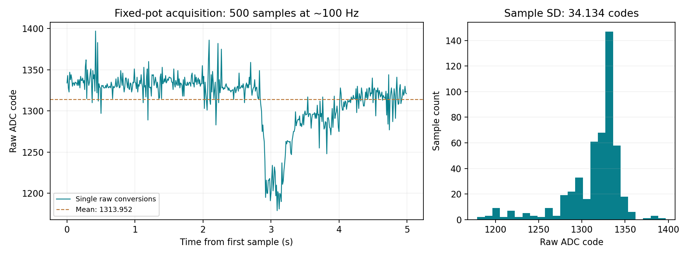
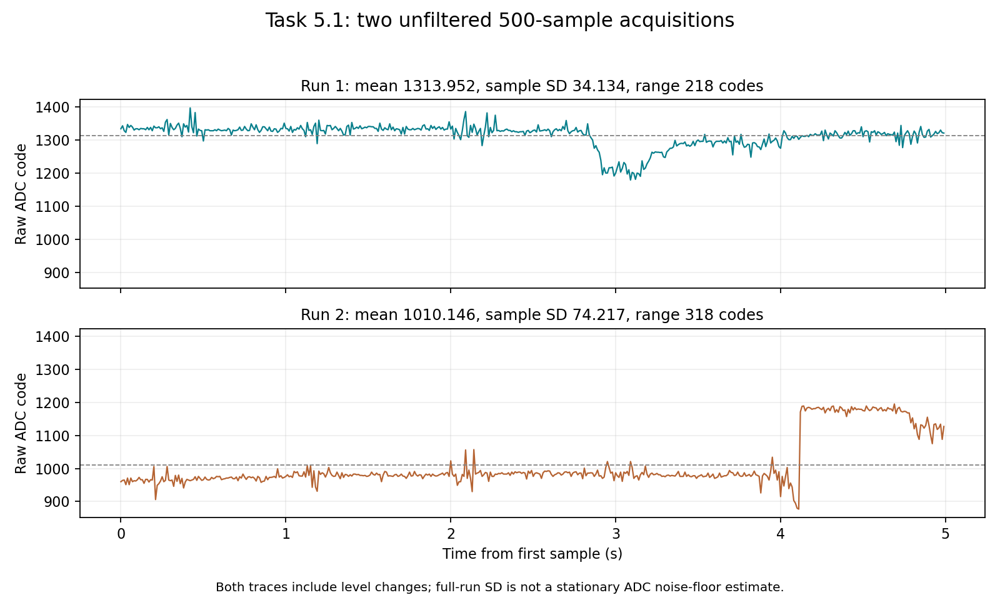
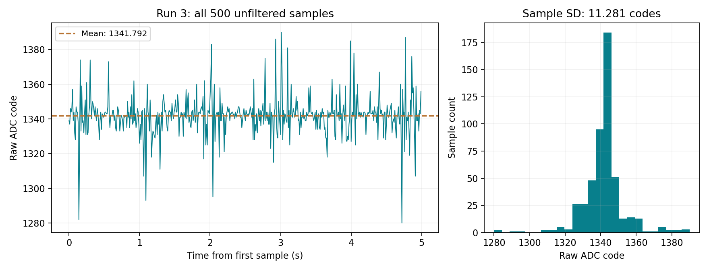

# Task 5.1 — Measurement-chain noise

Date: 2026-11-10

### Setup and acquisition

- ESP32 Dev Module; GPIO34; 12-bit ADC; 11 dB attenuation.
- Existing potentiometer wiring retained: ends to 3V3 and GND, wiper to GPIO34; shared ground with the meter.
- The operator was asked to hold the potentiometer, leads and probes still. The preceding Task 3a validation reference was 1.207 V, but no new simultaneous meter or supply reading was supplied for this capture. Do not assign 1.207 V as a verified constant voltage throughout this run.
- [Acquisition sketch](firmware/task5-noise-acquisition/task5-noise-acquisition.ino) compiled and uploaded through Arduino IDE.
- One `analogRead` conversion per stored sample; 500 samples, with a target interval of 10000 µs (100 Hz).
- Two-second startup wait plus 32 discarded warm-up conversions, spaced by 10 ms.
- Samples and acquisition timestamps were stored first. Serial printing occurred after acquisition, avoiding per-sample serial-output delays.
- No averaging, smoothing, spike removal or detrending was applied before storage or the statistics below.
- The sketch retained the captured dataset in RAM. Command `P` replayed the same dataset for export; this did not acquire a second run.
- Acquisition replaced the Task 3a firmware and cleared its in-memory calibration points. The separate saved Task 3a record and coefficients remain available.

### Data integrity and timing

The exported log was parsed and checked for exactly 500 sequential indices, 1 through 500, with strictly increasing acquisition timestamps. Statistics were independently recalculated from all 500 values and agree with the board's printed summary.

| Timing measure | Result |
|---|---:|
| First timestamp | 3 µs |
| Last timestamp | 4990027 µs |
| First-to-last duration | 4.990024 s |
| Mean sample interval | 10000.048 µs |
| Minimum sample interval | 9991 µs |
| Maximum sample interval | 10033 µs |

The desktop serial timestamps describe later data printing, not individual acquisition times. Use the stored microsecond timestamps for analysis.

### Unfiltered statistics

| Measure | Raw ADC codes |
|---|---:|
| Number of samples | 500 |
| Mean | 1313.952 |
| Sample standard deviation, denominator N−1 | 34.134147 |
| Minimum | 1179 |
| Maximum | 1397 |
| Range | 218 |

### Interpretation and limitations

The trace contains a clear level decrease near 3 s followed by recovery. Successive non-overlapping 100-sample blocks have means of 1334.30, 1334.24, 1315.47, 1269.91 and 1315.84 codes. The full-run standard deviation therefore includes a low-frequency level excursion as well as faster fluctuations and individual spikes.

The cause cannot be identified from this trace alone. Possible contributions include input or supply movement, contact instability, electrical interference and ADC behaviour. The value 34.134 codes must not be described as pure white ADC noise, an intrinsic sensor specification or absolute voltage accuracy. This experiment uses a potentiometer, not an LDR, so it does not quantify LDR sensor noise.

Retain the complete first run without removing the low segment. A repeated acquisition with stable leads, a fixed knob and a checked meter voltage would provide stronger evidence of the stationary chain noise floor. Any repeat should be stored separately rather than replacing this trace without explanation. Comparisons with the LDR should retain matching ADC settings and sample interval and account for differences in input operating point.

### Evidence

- [Exported serial log](evidence/Task5.1-Potentiometer-Serial-Log.txt)
- [Exactly 500 raw samples with acquisition timestamps](evidence/Task5.1-Potentiometer-Raw-Samples.txt)
- [Trace and distribution plot](evidence/Task5.1-Potentiometer-Noise.png)
- Arduino IDE screenshot showing N = 500, summary statistics and timing.

The current sketch stops acquiring after the one 500-sample run. `P` only reprints it. Pressing EN or power-cycling would start a new acquisition and overwrite the RAM dataset; the exported files preserve this run.

## 5.1 — Repeat acquisition (Run 2)

Date: 2026-11-10. The same sketch was uploaded again through Arduino IDE to start a new acquisition. This was a fresh capture, not a replay with command `P`. ADC settings, sample count and target interval were unchanged. No new simultaneous multimeter reading was provided, so a constant input voltage is not verified.

The exported Run 2 serial log contains two complete acquisition blocks, including the older run and startup text. Only the last complete `BEGIN_TASK5_1_POT_RAW` / `END_TASK5_1_POT_RAW` block was extracted as Run 2. Exactly 500 sequential indices and strictly increasing timestamps were verified. Independently calculated statistics agree with the board summary. All samples were retained without filtering, detrending or removal.

| Measure | Run 1 | Run 2 |
|---|---:|---:|
| Number of samples | 500 | 500 |
| Mean (raw codes) | 1313.952 | 1010.146 |
| Sample standard deviation (raw codes, N−1) | 34.134147 | 74.217472 |
| Minimum (raw codes) | 1179 | 877 |
| Maximum (raw codes) | 1397 | 1195 |
| Range (raw codes) | 218 | 318 |

Run 2 timestamps run from 2 to 4990026 µs, spanning 4.990024 s. Mean interval is 10000.048 µs; minimum and maximum intervals are 9990 and 10034 µs. The five successive 100-sample means are 967.85, 979.97, 984.74, 980.63 and 1137.54 codes.

Run 2 contains a brief downward excursion followed by an abrupt upward level change near 4.12 s. Its full-run standard deviation is greater than Run 1's, and the operating level differs between runs. These observations do not establish that intrinsic ADC noise increased: the data include level changes, and input stability was not independently verified. Neither full-run SD should be presented as a stationary ADC noise floor.

Before another baseline capture, secure the potentiometer and leads, check the wiper-to-GPIO34 connection and shared ground, and verify that the multimeter voltage remains steady during acquisition. The trace alone does not identify the cause of the change. Keep both original captures as evidence; do not select a short quiet segment and describe it as the complete repeat.

### Run 2 evidence

- [Exported serial log containing the new final block](evidence/Task5.1-Potentiometer-Run2-Serial-Log.txt)
- [Exactly 500 extracted Run 2 raw samples](evidence/Task5.1-Potentiometer-Run2-Raw-Samples.txt)
- [Two-run comparison plot](evidence/Task5.1-Potentiometer-Runs-Comparison.png)

## 5.1 — Repeat acquisition (Run 3)

Date: 2026-11-10. A fresh acquisition was started by uploading the unchanged sketch through Arduino IDE. The operator was asked to keep the knob and leads fixed. Settings remained GPIO34, 12-bit resolution, 11 dB attenuation and a 100 Hz target rate. No new simultaneous meter reading was supplied. No samples were removed, averaged, filtered or detrended.

The final complete acquisition block in the exported log was extracted. Exactly 500 sequential indices and strictly increasing timestamps were verified. Independently recalculated statistics agree with the board summary.

| Measure | Result |
|---|---:|
| Number of samples | 500 |
| Mean (raw ADC codes) | 1341.792 |
| Sample standard deviation (raw ADC codes, N−1) | 11.280924 |
| Minimum (raw ADC codes) | 1280 |
| Maximum (raw ADC codes) | 1390 |
| Range (raw ADC codes) | 110 |
| First / last timestamp (µs) | 2 / 4990026 |
| Acquisition span (s) | 4.990024 |
| Mean sample interval (µs) | 10000.048 |
| Minimum / maximum interval (µs) | 9990 / 10034 |

Successive 100-sample means are 1341.89, 1340.04, 1342.24, 1342.55 and 1342.24 codes, a span of 2.51 codes. Unlike the earlier traces, Run 3 shows no comparable sustained level excursion or abrupt persistent step. Individual spikes remain and are included in the statistics. Its sample SD is approximately 67% lower than Run 1 and 85% lower than Run 2, but these reductions describe observed full-run variation, not a demonstrated change in intrinsic ADC noise.

Use Run 3 as the provisional measurement-chain baseline for subsequent filtering comparisons, with these limits: the acquisition covers only five seconds; input and supply voltages were not independently logged; and the result includes the potentiometer, wiring, supply, interference and ADC. It does not isolate intrinsic ADC noise or establish absolute voltage accuracy. The three runs have different mean operating levels and must remain separate. Runs 1 and 2 remain available as evidence of instability.

### Run 3 evidence

- [Exported Run 3 serial log](evidence/Task5.1-Potentiometer-Run3-Serial-Log.txt)
- [All 500 raw samples with acquisition timestamps](evidence/Task5.1-Potentiometer-Run3-Raw-Samples.txt)
- [Run 3 trace and distribution](evidence/Task5.1-Potentiometer-Run3-Noise.png)
- Arduino IDE screenshot observed with the 500-sample summary.
