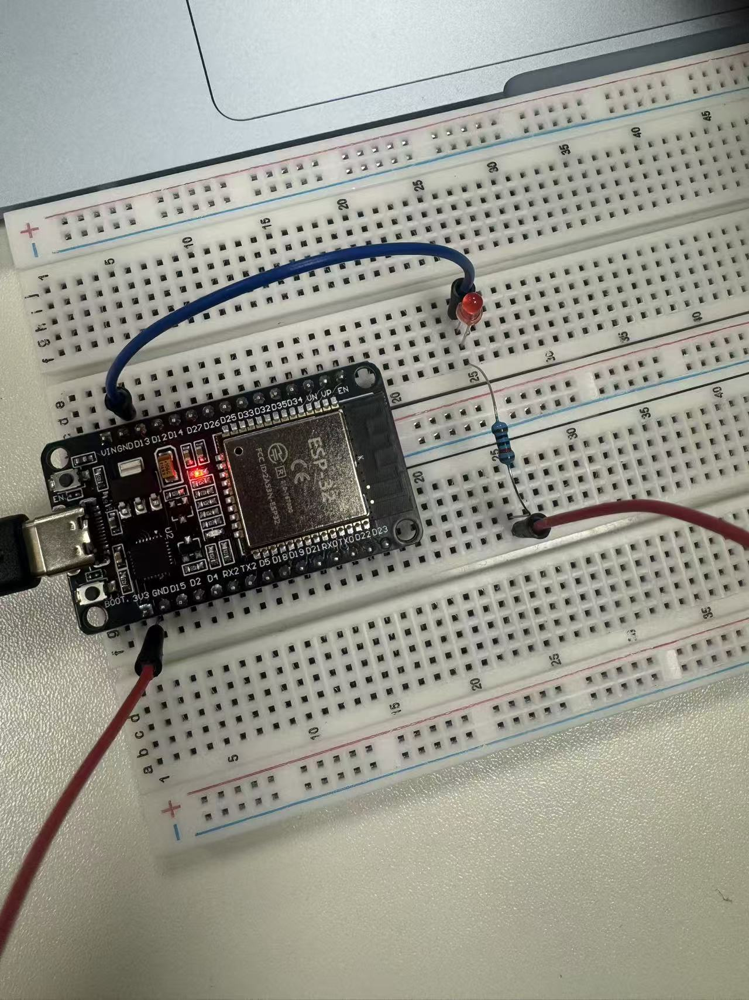

# Task 1 — Single LED PWM fade

[Module 5](../README.md) · [Portfolio](../../README.md) · [Study notes](../study-notes.md)

Date: 2026-11-18.

## Setup and upload

The operator reported connecting a red or yellow LED through a 220 ohm series resistor to GPIO16, with its cathode connected to GND. The supplied photograph shows a red LED and an initial connection near 3V3. The operator subsequently reported checking the wiring. The final wiring and resistor value were not independently measured.

The course PWM fade sketch was saved as [task1-led.ino](task1-led.ino), compiled and uploaded through Arduino IDE 2.3.11 to ESP32 Dev Module at /dev/cu.usbserial-0001. The IDE reported “Hash of data verified” followed by “Hard resetting via RTS pin”. IDE operation was delegated to the assistant at the student's request.

## PWM behaviour and observed result

The code increases PWM duty from 0 to 255 and decreases it to 0, delaying 8 ms at each step. The nominal complete cycle is 4.096 seconds plus execution overhead. Duty cycle is the fraction of each PWM period spent on.

After the original fade program was restored, the operator confirmed success. This records confirmation of visible fading. The cycle duration was calculated from the program and was not timed experimentally. The operator supplied an 8.567-second portrait video (720 × 1280, 30 fps). Sampled frames show a lit red LED with changing visible intensity. Camera exposure and compression limit brightness comparisons. The clip supports the operator’s confirmation of fading. The cycle duration remains a code-derived estimate.

[Course module](https://github.com/iotempire/iotempire-teaching/blob/main/full-classes/hsbi-sensors-actuators-10d/modules/05-leds-and-light-output.md)

## Diagnostic test

The operator reported no visible light after the fade upload and after reversing the LED. A separate [GPIO16 on/off diagnostic](diagnostics/gpio16-blink/gpio16-blink.ino) was compiled and uploaded through Arduino IDE. Serial Monitor at 115200 baud showed repeated alternating GPIO16 HIGH and LOW messages at approximately two-second intervals, confirming program execution. Pin voltage was not measured during this diagnostic. The diagnostic was subsequently replaced with the original Task 1 PWM fade at the operator’s request. The restore upload completed with hash verification and an automatic reset. The operator then confirmed that the restored fade worked. The exact cause of the initial failure was not established.

## Video evidence

[Recorded LED fade](evidence/pwm-fade.mp4)

The original MP4 was archived byte-for-byte from the supplied attachment.

## Wiring evidence and project format

This photograph records the initial troubleshooting state, not independently verified final wiring. The fade video records the subsequent successful output. This folder intentionally retains the tested Arduino IDE sketch rather than presenting an untested PlatformIO conversion.

[Module index](../README.md)
