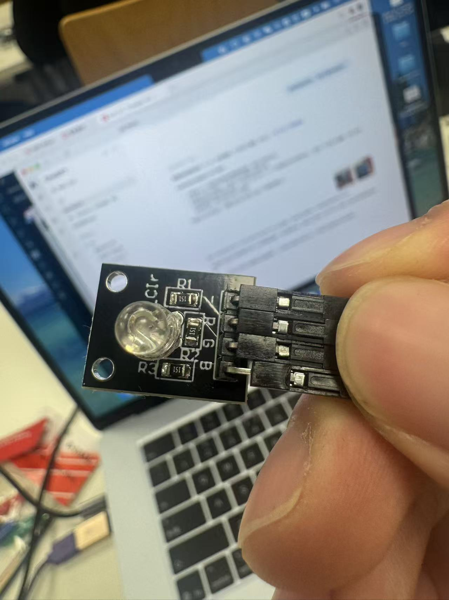
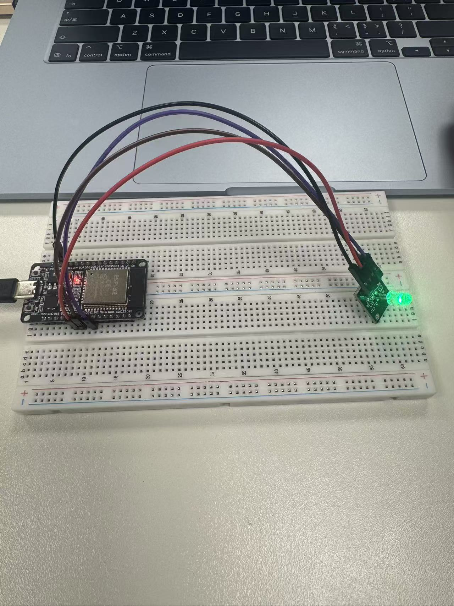
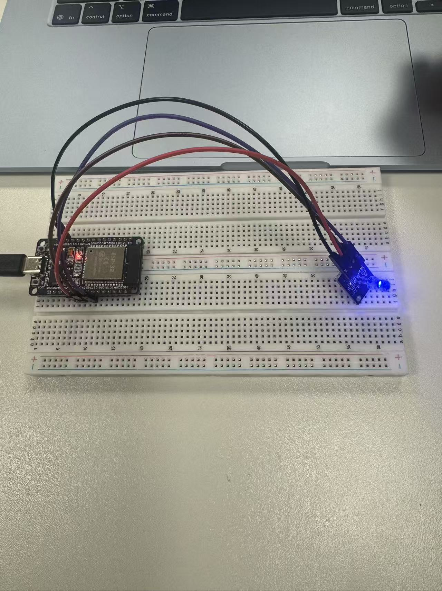

# Task 2 — RGB LED serial control

[Module 5](../README.md) · [Portfolio](../../README.md) · [Study notes](../study-notes.md)

Date: 2026-11-18. Status: compiled, uploaded and serial checks passed. Red, green and blue output confirmed. Channel currents were calculated from measured resistor voltages and nominal onboard resistance.

## Hardware

The experiment uses the original classic ESP32 Dev Module (PlatformIO board `esp32dev`) and an RGB LED breakout module. A close-up photograph shows three onboard resistors marked `151`, each nominally 150 ohms. No additional external resistors were reported. This differs from the workbook circuit, which uses a discrete RGB LED and three 220-ohm resistors. A photographed MH-ET LIVE MiniKit was considered, but the operator confirmed continuing with the original board.

| LED connection | ESP32 connection |
| --- | --- |
| R, through onboard 150-ohm resistor R1 | GPIO16 / RX2 |
| G, through onboard 150-ohm resistor R2 | GPIO17 / TX2 |
| B, through onboard 150-ohm resistor R3 | GPIO18 |
| Common cathode (module minus pin) | GND |

`COMMON_ANODE` is false. Observed channel behaviour with this configuration and the common connection to GND is consistent with a common-cathode module.



## Build, upload and serial commands

```sh
pio run -t compiledb
pio run
pio run -t upload --upload-port /dev/cu.usbserial-0001
pio device monitor --port /dev/cu.usbserial-0001
```

Serial speed is 115200 baud. Each command ends with Enter. RGB integers are clamped to 0–255. Exactly three whitespace-separated decimal integers are required. Invalid or overlong lines report an error and preserve the previous colour.

```text
255 0 0
0 255 0
0 0 255
255 255 255
0 0 0
```

The firmware echoes applied values with APPLIED R=... G=... B=.... Command 300 -10 128 should apply 255 0 128. Commands with missing values, extra values or non-integer text should report ERROR.

## Verification and current measurements

Both pio run -t compiledb and pio run succeeded. The upload completed with hash verification and a hardware reset. The build used Espressif32 8.0.0 and Arduino-ESP32 3.3.12. Ten serial cases passed, covering valid colours, value clamping, missing or excess values, fractional input, text and an overlong line. The verification sequence ended with 255 0 0. [Serial verification](evidence/serial-check.txt)

The first connection produced garbled startup data and repeated off-state echoes before clean command responses. Its log is retained as [first-check output](evidence/serial-first-check.txt). Verification was repeated with input buffers cleared and DTR/RTS disabled before opening the port, and all ten cases passed. The cause of the first connection artifacts is unverified. The operator confirmed red, green and blue output. Green and blue photographs are archived. The operator measured the voltage across the two metal terminals of each onboard resistor while its channel was fully on. Currents below are inferred using I = U / R with the nominal 150-ohm value, rather than measured directly with a series ammeter. Resistor tolerance and meter uncertainty were not quantified.

| Channel command | Resistor | Measured resistor voltage (V) | Calculated current (mA) |
| --- | --- | --- | --- |
| 255 0 0 | R1 | 1.13 | 7.53 |
| 0 255 0 | R2 | 0.66 | 4.40 |
| 0 0 255 | R3 | 0.58 | 3.87 |

The initial reported red reading of 1.95 V was superseded by the operator's explicit measurement of 1.13 V across R1's two metal terminals. Red draws the highest current, followed by green and blue. Different LED forward voltages are consistent with this imbalance despite equal nominal series resistances.

During later colour changes, the serial connection intermittently failed with `termios.error: (22, Invalid argument)`. After USB reconnection, commands were retried; green and blue acknowledgments were observed. The final acknowledged output was `APPLIED R=0 G=0 B=255`. The underlying connection fault was not diagnosed.

The assistant initially documented the workbook's 220-ohm circuit before checking the actual module. The close-up corrected this assumption to three onboard 150-ohm resistors; calculations use the observed markings.

The assistant scaffolded the project at the operator's request. The board profile was adapted to the observed ESP32 Dev Module. Physical confirmation and measurements are performed by the operator.

[Course module](https://github.com/iotempire/iotempire-teaching/blob/main/full-classes/hsbi-sensors-actuators-10d/modules/05-leds-and-light-output.md)


## Physical colour checks

The operator confirmed red after command 255 0 0. A subsequent command 0 255 0 was sent through the PlatformIO serial monitor inside VS Code, which returned APPLIED R=0 G=255 B=0. The operator confirmed green and supplied a photograph.





The operator confirmed blue for command 0 0 255, following its acknowledgment in the VS Code serial monitor.



## Project files

[Firmware](src/main.cpp) · [PlatformIO settings](platformio.ini) · [Project instructions](AGENTS.md) · [Module index](../README.md)

The platform version is pinned to Espressif32 8.0.0, matching the successful recorded build.
