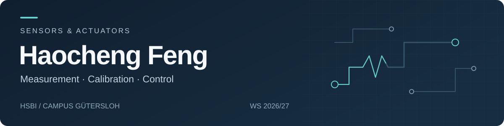
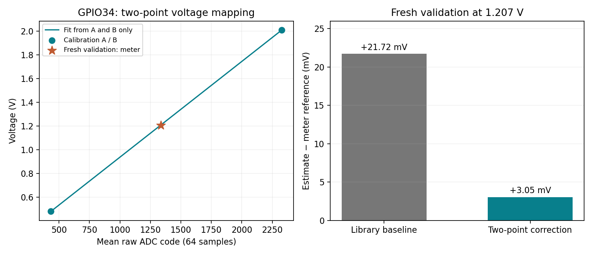

# Sensorik und Aktorik Portfolio

Experiments, code and learning reflections by **Haocheng Feng** · HSBI, Campus Gütersloh · Winter semester 2026/27.

[Modules](#modules) · [Selected evidence](#selected-evidence) · [Reflections](Reflections/README.md) · [Hardware](Hardware/README.md) · [Completeness review](PORTFOLIO-REVIEW.md)

## Modules

| Module | Focus and recorded evidence | Reflection |
| --- | --- | --- |
| [00 · Pre-study](pre-study/README.md) | Wokwi ADC/LED experiment, sensor datasheets and project concept | [Open questions](pre-study/README.md#reflection-and-open-questions) |
| [01 · Foundations](Module01/README.md) | Digital I/O, debounce, serial plotting, ADC and LDR measurements | [Reflection 1](Reflections/ref01.md) |
| [02 · Buses and I²C](Module02/README.md) | UART loopback, SPI study and credited teammate bus experiments | [Reflection 2](Reflections/ref02.md) |
| [03 · Characterization](Module03/README.md) | Sensor response, calibration, noise, filtering and hysteresis | [Reflection 3](Reflections/ref03.md) |
| [04 · Liquid measurement](Module04/README.md) | Retrospective study of Zhenning Yu's tank experiments | [Reflection 4](Reflections/ref04.md) |
| [05 · Light output](Module05/README.md) | LED fade, serial RGB control and eight-pixel strip power budget | [Reflection 5](Reflections/ref05.md) |

The module pages map learning goals to evidence and identify remaining work. Documentation coverage is not a claim that every experiment or competency is complete. [Current review and priorities](PORTFOLIO-REVIEW.md)

## Selected evidence

| Question | Recorded result | Explore |
| --- | --- | --- |
| Did the ADC correction help at a fresh point? | Residual changed from **+21.72 mV to +3.05 mV** at a 1.207 V reference. | [Calibration and validation](Module03/adc-calibration/README.md) |
| Did decision hysteresis reduce switching? | **5 switches → 1** on the same measured LDR trace; the return/reset was not captured. | [Decision comparison](Module03/noise-and-filtering/ldr-hysteresis/README.md) |
| How much did the eight-pixel strip draw? | **0.09 A** at white with luminance **80/255**, excluding the ESP32. | [Measured and calculated power](Module05/task3-strip/power-budget.md) |

### From calibration to a checkable result

*The third point was excluded from fitting. This result supports the local correction at that point; it is not a full-range accuracy or uncertainty claim.*

[Watch the LED fade](Module05/task1-led/evidence/pwm-fade.mp4) · [Inspect the RGB module](Module05/task2-rgb/README.md#physical-colour-checks) · [Compare the LDR fits](Module03/ldr-characterization/README.md#six-point-model-analysis)

## Checkpoint 1 — Modules 1–3

| Module | Learning goals | Evidence to discuss |
| --- | --- | --- |
| [Foundations](Module01/README.md) | [LG1–LG6](Module01/README.md#learning-goals) | [ADC resolution comparison](Module01/potentiometer-adc/README.md) and [120 LDR readings](Module01/ldr-divider/README.md). |
| [Buses](Module02/README.md) | [LG1–LG6](Module02/README.md#learning-goals) | [UART exact-match result](Module02/uart-loopback/evidence/observed-loopback.txt), [SPI research](Module02/bus-spi.md), and [credited I²C evidence](Module02/README.md#teammate-contributions). |
| [Characterization](Module03/README.md) | [LG1–LG5](Module03/README.md#learning-goals) | [Fresh-point calibration](Module03/adc-calibration/README.md), [water/air response](Module03/ds18b20/README.md) and [filter trade-offs](Module03/noise-and-filtering/README.md). |

## Current status

The six module folders contain the available evidence through Day 5. Reflections 1–3 retain prompts for personal feedback and contributions; Reflection 4 is retrospective study following absence; Reflection 5 is a draft based on the LED session. The fastest remaining evidence additions are a working-strip photograph/video and genuine peer-discussion notes. [Full review](PORTFOLIO-REVIEW.md#suggested-next-actions)

This repository includes Module05 and the latest review additions. Course-channel sharing has not been recorded.

## Collaboration and methods

- **Haocheng Feng** maintains this portfolio. [GitHub profile](https://github.com/HaochengFeng1217)
- **Zhenning Yu** performed the linked Module 2 Tasks 5, 6, 7 and 9 and all Module 4 experiments. Haocheng was absent from Module 4; the reflection does not claim practical participation. [Partner portfolio](https://github.com/LudwigMo/sensorik-aktorik-portfolio)
- **AI assistance** is identified in the experiment and reflection records. Student observations, instrument readings, calculated results and teammate evidence are distinguished.
- All current lab records are written in **English**. Original data and unsuccessful attempts are retained with their limitations.

## Course references

[Course workbook](https://github.com/iotempire/iotempire-teaching/tree/main/full-classes/hsbi-sensors-actuators-10d) · [Pre-study guide](https://github.com/iotempire/iotempire-teaching/blob/main/full-classes/hsbi-sensors-actuators-10d/pre-study.md) · [Syllabus](https://github.com/iotempire/iotempire-teaching/blob/main/full-classes/hsbi-sensors-actuators-10d/syllabus.md) · [Portfolio template](https://github.com/iotempire/iot-portfolio-template)

The live workbook may change. Local arrangements follow the course LMS or instructor. The archived LMS PDFs are dated 25 September 2026, revision `31aa6ca`.

---

[Completeness review](PORTFOLIO-REVIEW.md) · [Reflection index](Reflections/README.md) · [Hardware inventory](Hardware/README.md) · [New module template](ModuleNN.md)

*Last documentation review: 18 November 2026.*
