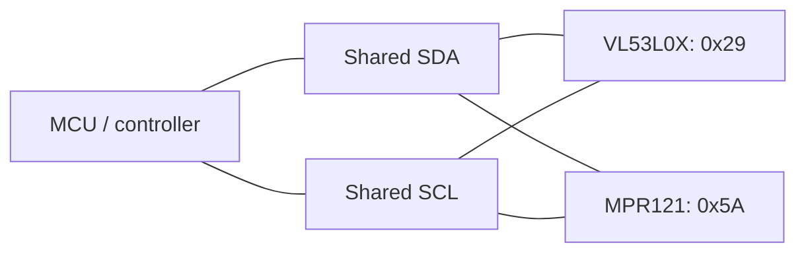

# Module 0: Pre-study

Course: HSBI Sensorik und Aktorik, WS 2026/27  
GitHub account: HaochengFeng1217  
Full name: Haocheng Feng  
Entry started: 2026-10-20  
Status: **In progress - Questions 1-5 documented; remaining answers pending.**

## Preparation log

- Personal portfolio created from the course template.
- ESP32 potentiometer-to-LED simulation run on 2026-10-21.
- Compared 12-bit and 10-bit readings and tested a four-level brightness mapping.
- Saved the project, source files, serial output, and three screenshots.
- Documented the sensor-to-system chain for screen auto-rotation on my iPhone 15 Pro Max.
- Added manufacturer datasheet notes for VL53L0X and MPR121, including address conventions and specification conditions.
- Added two hypothetical scale examples to explain accuracy and precision.
- Added an I²C shared-bus explanation, signal diagram, and likely communication problems.
- Questions 6-8 and the remaining preparation checks are still pending.

## Completion checklist

- [x] Personal public GitHub repository created with "Use this template".
- [x] Initial pre-study entry structure prepared.
- [x] Full name added to the portfolio homepage.
- [ ] Guiding Questions 1-8 answered and understood.
- [x] VL53L0X and MPR121 datasheet notes completed, with sources and conditions.
- [x] Wokwi ESP32 potentiometer-to-LED simulation run.
- [x] ADC resolution changed and actual observations recorded.
- [x] Coarse threshold/step behaviour tested and described.
- [x] Real circuit and serial-output screenshots, or a saved simulation link, added.
- [ ] 5-10 line project abstract added, identifying two sensors and one actuator.
- [ ] Remaining pre-study answers completed and final links checked.
- [ ] Instructor access arranged through the course's confirmed process.
- [ ] Arduino IDE v2 or PlatformIO readiness checked on the Mac.

## 1. Sensor-to-system chain

**Device:** My iPhone 15 Pro Max. Screen auto-rotation is a visible example of a
system responding to a change in the device's physical orientation.

**Simplified chain:** Acceleration along the phone's axes → sensing element →
signal conditioning → ADC → sensor processing and host processor → screen orientation.

Apple lists a high-g accelerometer, a high dynamic range gyroscope, and the A17 Pro
chip for this model. Its Core Motion documentation describes a gravity vector in
the device's reference frame. When the phone is held still in a different orientation,
the gravity components along its axes change; this provides information for estimating
tilt. [iPhone specifications](https://support.apple.com/en-us/111828),
[Core Motion: gravity](https://developer.apple.com/documentation/coremotion/cmdevicemotion/gravity).

The sensing, conditioning, and conversion stages below use a representative
capacitive MEMS accelerometer model.

| Stage | Role in the chain |
|---|---|
| Physical quantity | Acceleration along three axes. At rest, the gravity components provide a reference for tilt. |
| Transducer | In a capacitive MEMS design, acceleration moves a tiny suspended mass and changes a differential capacitance. |
| Signal conditioning | Sensing electronics convert the small capacitance change into an electrical signal suitable for conversion. |
| ADC | Converts the analog sensor signal into digital acceleration readings. The representative sensor integrates this conversion before its digital interface. |
| MCU / processor role | Sensor processing and the phone's processor/operating system use motion data to estimate orientation. The phone has an A17 Pro application processor; the exact sensor-hub hardware and division of processing are unconfirmed. |
| System | In an app that supports rotation, with orientation lock off, the interface can switch between portrait and landscape. |

The [ADXL345 datasheet, Rev. G](https://www.analog.com/media/en/technical-documentation/data-sheets/adxl345.pdf)
illustrates the integrated sensing electronics, ADC, digital filter, and digital
interface in Figure 1 (p. 1), and explains capacitive sensing on p. 12. It is an
example for the model above; the actual sensor part number, ADC resolution, interface,
and rotation algorithm in my iPhone remain unconfirmed.
[Apple's rotation guide](https://support.apple.com/guide/iphone/rotate-your-iphone-screen-iph3badf94ec/27/ios/27)
describes the user-visible rotation behavior and orientation lock.

## 2. Wokwi observations: ADC resolution

Run date: 2026-10-21. [Open the saved Wokwi project](https://wokwi.com/projects/478439382770685953).

The ESP32 reads a potentiometer on GPIO34 and drives a red LED through a
330 ohm resistor on GPIO2. The serial monitor records the raw ADC reading and
the PWM brightness value.

| ADC setting | Configured brightness levels | Observed ADC endpoints | Example observed PWM values |
|---|---|---|---|
| 12 bits | 256 | 0-4095 | 0, 64, 128, 192, 255 |
| 10 bits | 256 | 0-1023 | 0, 64, 128, 192, 255 |
| 10 bits, coarse output | 4 | 0-1023 | 0, 85, 170, 255 |

A 12-bit ADC has 4096 representable codes; a 10-bit ADC has 1024. Reducing the
resolution therefore makes the nominal ADC step four times coarser for the same
input span. The endpoint ranges above were observed; the code counts are theoretical,
and do not imply that every possible code was sampled.

For a control change from 512 to 513, the raw reading changed from 2050 to 2054
at 12 bits and from 512 to 513 at 10 bits. The LED brightness value stayed at 128
in both cases because the output mapping uses 256 PWM levels. Resolution changed;
this experiment does not demonstrate a change in measurement accuracy.

With four brightness levels, the PWM output jumped from 0 to 85 at raw 256,
from 85 to 170 at raw 512, and from 170 to 255 at raw 768. Many input values map
to the same output, so the LED changes abruptly at these thresholds.

- [Wiring, complete sample tables, and reproduction steps](wokwi/README.md)
- [Program](wokwi/sketch.ino) and [circuit configuration](wokwi/diagram.json)
- [Captured serial readings](wokwi/serial-output.md)
- Screenshots: [12-bit](images/wokwi-adc12.png), [10-bit](images/wokwi-adc10.png),
  [four-level output](images/wokwi-coarse4.png)

## 3. Datasheet question

**Chosen sensor: VL53L0X.** The [notes for both required sensors](datasheets.md)
cover their supply, interface, range, resolution, and limitations.

The VL53L0X uses **I²C, up to 400 kHz**. Its default **7-bit address is 0x29**.
The datasheet writes **0x52** for the address byte used for writing and **0x53** for
reading; these include the R/W bit (Table 2, p. 3; Section 4, Figure 14, p. 15).

The datasheet characterizes ranging accuracy using **standard deviation**, including
measurement-to-measurement and part-to-part dispersion. One Table 13 example is
**4% at 120 cm with a 33 ms timing budget**, for a white target of **88% reflectance**,
indoors with **no infrared background**. Conditions include **2.8 V**, **23°C**, offset
correction at **10 cm**, a target covering the full **25° field of view**, and a
minimum **94% detection rate**. This standard-deviation figure is not a guaranteed
maximum absolute error for every reading.

Source: STMicroelectronics, [VL53L0X datasheet](https://www.st.com/resource/en/datasheet/vl53l0x.pdf),
**DS11555, Rev. 6, June 2024**, Section 6.3.1 and Table 13, **p. 23**.
These are manufacturer specifications; no hardware accuracy measurement has been performed.

## 4. Accuracy versus precision

Accuracy concerns how close a measured value is to the true value; in practice,
a suitable reference value is used for comparison. Precision concerns how closely
repeated measurements agree under the same specified conditions.

The following everyday examples are hypothetical.

- **Precise but inaccurate:** A bathroom scale is checked with a reference load
  of **20.0 kg**. It repeatedly displays **22.0 kg, 22.0 kg, and 22.0 kg**.
  The displayed readings agree closely, but they are all **2.0 kg too high**.
  A consistent offset can therefore give repeatable readings that are wrong.
- **Accurate but imprecise, in the everyday sense of correct on average:** Suppose
  a kitchen scale's readings are scattered around a **100 g** reference mass.
  Example readings are **95 g, 100 g, and 105 g**. Their mean is **100 g**, but
  the individual readings vary widely, so repeatability is poor.

In simple terms, accuracy asks "How close is the result to the reference?" and
precision asks "How close are the repeated results to each other?" Strictly, the
second example illustrates good trueness with low precision, assuming the long-run
mean remains near the reference. One correct sample mean does not establish the
instrument's accuracy or make every individual reading accurate.

Terminology checked against JCGM's International Vocabulary of Metrology:
[accuracy, 2.13](https://jcgm.bipm.org/vim/en/2.13.html),
[trueness, 2.14](https://jcgm.bipm.org/vim/en/2.14.html), and
[precision, 2.15](https://jcgm.bipm.org/vim/en/2.15.html).

## 5. I²C anticipation

**Initial explanation:** In a single-controller setup, several sensors connect in
parallel to the same **SDA** data line and **SCL** clock line. They also need a common
ground and compatible logic levels. Open-drain outputs pull a line low; pull-ups
restore the high level when it is released.

The controller starts a transfer and sends a target address with a read/write bit.
A ready sensor with the matching address acknowledges and participates. The address
therefore selects the sensor without a separate chip-select wire for every device.

For the two sensors in the [datasheet notes](datasheets.md), the default VL53L0X
address is **0x29** and the MPR121 address is **0x5A** when ADDR is tied to VSS.
Both are **7-bit addresses**, so this pair has no address conflict. The exact
breakout boards' logic levels and pull-ups still need checking before connection.

This is a signal-topology diagram; power, ground, and pull-up wiring are omitted.

| Possible problem | Why it matters |
|---|---|
| Two devices with the same address | Both may respond, so the controller cannot select them independently. A supported address change or separate bus/multiplexer may be needed. |
| Wrong address convention | Passing an 8-bit address byte to an API expecting a 7-bit address selects the wrong target. |
| Missing or unsuitable pull-ups | Lines may not rise correctly, or devices may need to sink too much current. Pull-ups already fitted to several boards combine in parallel. |
| Incompatible logic levels or missing common ground | A valid high/low level may not be recognized; excessive pin voltage can damage a device. |
| Long wires, high bus capacitance, or excessive clock speed | Signal rise times and timing requirements may no longer be met, causing communication errors. |

**Question to revisit in Module 2:** How should the effective pull-up resistance be
chosen when several breakout boards already contain pull-ups, and how can the signal
rise time be checked?

Bus principles checked against NXP's [I²C-bus specification and user manual,
UM10204, Rev. 7.0, 1 October 2021](https://www.nxp.com/docs/en/user-guide/UM10204.pdf),
Sections **3.1.1**, **3.1.6**, **3.1.10**, and **7.1**.

## 6. Actuator choice: small door latch

Choose an actuator for moving a small door latch once every few minutes.
Compare torque, control, and power; identify an unsuitable alternative.

- Choice and assumptions about the latch: TODO
- Torque / control / power justification: TODO
- Rejected alternative and reason: TODO

## 7. LED power calculation

Use the guide's assumption of 30 WS2812 LEDs, each up to approximately 60 mA at full white.
This is a calculation, not a current measurement.

- Calculation with units: TODO
- Required supply capability and practical margin: TODO
- Why the microcontroller's 5 V pin is unsuitable for this load: TODO

## 8. Project abstract

Status: **Idea not yet selected.**

Write 5-10 lines about a concrete user, scenario, problem, sensor inputs,
and actuator response. This is a tentative direction.

TODO: personal project abstract.

- Sensor 1 and purpose: TODO
- Sensor 2 and purpose: TODO
- Actuator and response: TODO
- Main uncertainty / question to investigate: TODO

## Additional study notes

### Measurement and uncertainty

- True value, error, and uncertainty: TODO
- Resolution versus accuracy: TODO
- Systematic versus random error; calibration versus averaging: TODO
- Sampling, Nyquist condition, and quantization: TODO

### Actuators

- PWM duty cycle, LED dimming, and servo control: TODO
- Plain LED current limiting: TODO
- WS2812 versus plain RGB LEDs and power requirements: TODO
- Servo, DC motor, and stepper comparison: TODO
- Driver electronics for motors and relays: TODO

## Reflection and open questions

- Completed: portfolio structure, the phone auto-rotation chain explanation, the Wokwi ADC/LED experiment with saved evidence, both sensor datasheet notes, the accuracy/precision comparison, and the I²C shared-bus explanation.
- Remaining: Questions 6-8, including a personal project abstract, and the remaining preparation checks.
- Open question: how real ESP32 ADC noise, offset, and non-linearity differ from this simulation.
- Verification: checked the circuit against the component pin references, compared the serial
  ranges with the ADC API, and tested the output threshold boundaries in the running simulation.

## Sources and version note

- Uploaded Pre-Study Guide and Syllabus: generated 2026-09-25, source revision 31aa6ca.
- [Live pre-study guide](https://github.com/iotempire/iotempire-teaching/blob/main/full-classes/hsbi-sensors-actuators-10d/pre-study.md)
- [Live syllabus](https://github.com/iotempire/iotempire-teaching/blob/main/full-classes/hsbi-sensors-actuators-10d/syllabus.md)
- [Portfolio template](https://github.com/iotempire/iot-portfolio-template)

The PDF names this file `pre-study/README.md` (or `00-pre-study.md`).
The uploaded PDFs and live workbook differ on preparation time and checkpoint timing;
confirm the arrangement for this cohort in the LMS or with the instructor.
